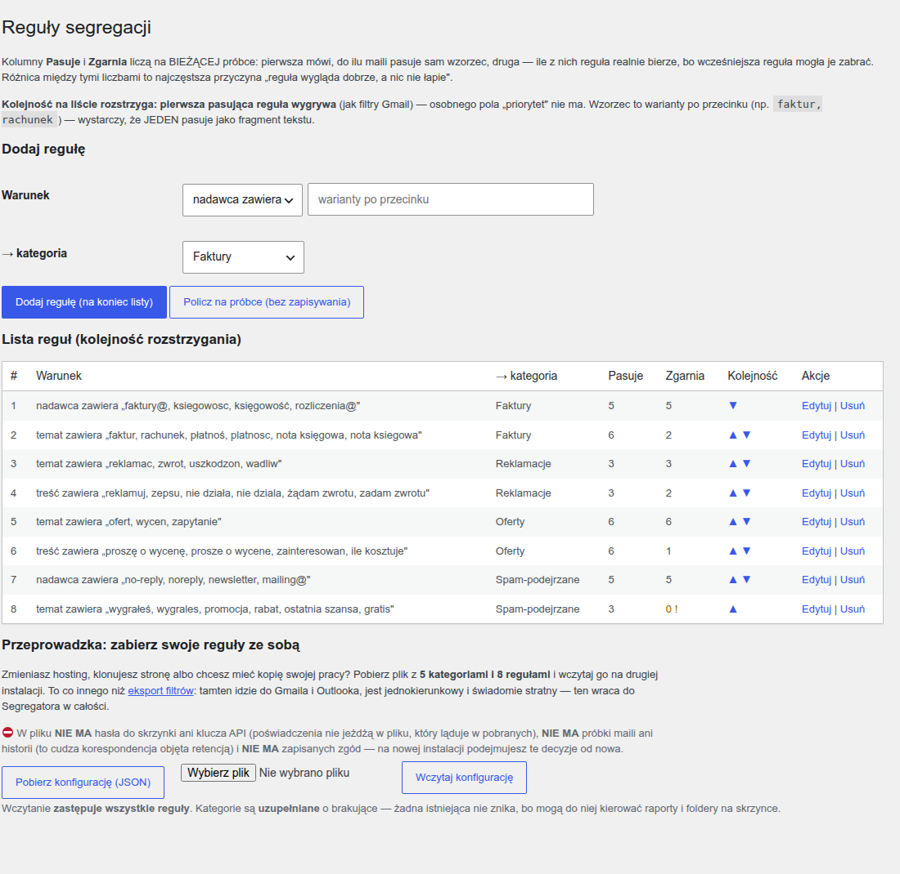

# Sklep Agentów

Sklep z wtyczkami-botami AI, działający w całości na Twoim WordPressie — **trzy wtyczki**:
sklep oraz dwa produkty, które sklep sprzedaje.

> **Chcesz tylko zainstalować?** Pobierz paczkę z **[najnowszego wydania](https://github.com/szydlowskikonrad95-art/sklep-agentow/releases/latest)**
> i zacznij od pliku `PRZECZYTAJ-MNIE.txt`, a potem `INSTRUKCJA-INSTALACJI.md` — krok po kroku, bez wiedzy
> programistycznej. Reszta tego dokumentu opisuje system od strony technicznej.

| Wtyczka | Rola | Najkrócej |
|---|---|---|
| **Sklep Agentów** (`sklep-agentow`) | sklep | lista i strony produktów pod `/sklep/`, płatność kartą przez Stripe Checkout, mail z linkiem do pobrania (72 h, 10 pobrań), brama pobrań, panel w kokpicie: pulpit, produkty, zamówienia, opinie, dziennik, ustawienia |
| **ChatBot LIVE** (`chatbot-live`) | produkt 1 | bot czatu na stronę: odpowiada z własnej bazy pytań, zbiera kontakty, opcjonalny tryb AI, statystyki i raport luk |
| **Segregator maila** (`segregator-maila`) | produkt 2 | rozdziela pocztę do kategorii według Twoich reguł i pokazuje raport, ile zrobił |

Dane żyją w **własnych tabelach** bazy WordPressa (nie we wpisach): zamówienia z kopią danych produktu
z chwili zakupu, każde przejście stanu jednorazowe, zgoda kupującego zapisana z treścią i czasem, dziennik
zdarzeń i logowań. Schemat tabel i stałe: `DOKUMENTACJA-TECHNICZNA.md` w każdej wtyczce.

## Wymagania

WordPress 6.7+ (boty: 6.0+) · PHP 8.1+ · bezpośrednie odnośniki inne niż „Zwykłe” · konto Stripe
(testowe wystarczy) · wysyłka maili z serwera albo wtyczka SMTP. Sprawdzone na WordPressie 7.1
i PHP 8.4; deklarowane minimum WP 6.7 / PHP 8.1 sprawdzone na czystym stosie z tymi wersjami
i analizą statyczną pod PHP 8.1.

## Szybki start

1. **Ustawienia → Bezpośrednie odnośniki** — wybierz strukturę inną niż „Zwykłe”.
2. **Wtyczki → Dodaj nową → Wyślij wtyczkę na serwer** — `sklep-agentow-<wersja>.zip` → Zainstaluj → Włącz.
   Sklep sam tworzy strony „Sklep” i „Dziękujemy za zakup” oraz szkice regulaminu i polityki prywatności.
3. **Sklep Agentów → Ustawienia** — klucz sekretny Stripe (testowy), sekret webhooka, nadawca maili,
   mail kontaktowy, waluta.
4. **W Stripe** dodaj webhook na `https://TWOJA-DOMENA/wp-json/sklepag/v1/webhook`.
5. **Sklep Agentów → Produkty → Dodaj produkt** — nazwa, opisy, cena, plik ZIP (to zipy botów z paczki),
   zaznacz „W sprzedaży”. Zrób zakup kartą testową i sprawdź zamówienie na Pulpicie.

Pełny opis: `dokumentacja/INSTRUKCJA-INSTALACJI.md` (wdrożenie) i `wtyczki/sklep-agentow/INSTRUKCJA.md`
(obsługa na co dzień, ze zrzutami).

## Jak biegnie zakup

Gość ogląda listę produktów i stronę produktu, klika „Kup”, zaznacza zgodę na dostarczenie treści
cyfrowej i trafia na stronę płatności Stripe. Po zapłacie Stripe wysyła powiadomienie (webhook
z podpisem); niezależnie od niego sklep co 10 minut sam dopytuje Stripe o opłacone sesje. Zamówienie
przechodzi ze stanu „opłacone” w „mail wysłany” dokładnie raz — kupujący dostaje jeden mail z linkiem
do pobrania, potwierdzeniem zgody, krótką instrukcją i jednorazowym linkiem do opinii. Plik wydaje
wyłącznie sklep, po sprawdzeniu tokenu, terminu i limitu; pliki produktów leżą w katalogu chronionym
o losowej nazwie. Zwroty i spory z powiadomień Stripe trafiają do zamówienia i do statystyk.
Rysunek: `dokumentacja/diagramy/01-sklep-droga-zakupu.png`.

## Jak to wygląda

| Lista sklepu | Pulpit właściciela |
|---|---|
|  |  |

| ChatBot LIVE — okno rozmowy | Segregator maila — reguły |
|---|---|
|  |  |

Wszystkie zrzuty powstają maszynowo, z prawdziwej przeglądarki (`testy/zrzuty-panelu.js`,
`testy/zrzuty-instrukcje.js`) — nie są retuszowane.

## Co jest w wydaniu

Paczka zbiorcza `sklep-agentow-KLIENT-<wersja>.zip` (składa ją `narzedzia-qa/pakuj-dla-klienta.sh`):
trzy zipy wtyczek · `PRZECZYTAJ-MNIE.txt` · `INSTRUKCJA-INSTALACJI.md` · `diagramy/` (PNG) ·
`SHA256SUMS.txt` (sprawdzenie: `sha256sum -c SHA256SUMS.txt`). W każdym zipie wtyczki: `INSTRUKCJA.md`,
`readme.txt`, `CHANGELOG.md`, `DOKUMENTACJA-TECHNICZNA.md`, `DIAGRAM-PRZEPLYWU.svg`, `LICENSE`;
w paczce sklepu dodatkowo `PONAD-SPECYFIKACJE.md`.

## Czego ten system NIE robi (świadome granice)

Nie zakłada kont kupującym, nie obsługuje płatności cyklicznych, kuponów ani przecen, nie dotyka motywu
ani innych wtyczek, nie wysyła danych nigdzie poza Stripe. **Sklep jest oddawany z kluczami testowymi
Stripe** — płatności nie są pobierane, kupujący widzi oznaczenia trybu testowego. Tryb wynika z prefiksu
klucza sekretnego (`sk_test_…` kontra `sk_live_…`), więc podmiana klucza zdejmuje te oznaczenia sama;
pozostałe kroki przejścia na produkcję opisuje `INSTRUKCJA-INSTALACJI.md`, rozdział „Test a produkcja”.

## Struktura repo

| Katalog / plik | Co trzyma |
|---|---|
| `wtyczki/` | kod trzech wtyczek, każda z własną dokumentacją, instrukcją, zrzutami i licencją |
| `boty/` | zaplecze botów: `paczki/` (wydane zipy — każda wersja zostaje), `buduj-paczki.sh` (allowlista + zamek wydanych wersji), a obok plany napraw, szkice, krytyki i briefingi z czasu budowy botów |
| `dokumentacja/` | instrukcja instalacji, diagramy PNG i skrypt, który je renderuje ze źródeł SVG |
| `dla-klienta/` | `PRZECZYTAJ-MNIE.txt` — pierwszy plik wydania |
| `testy/` | testy na żywym stosie WordPressa: przeloty E2E, sondy strażników, zrzuty, zgodność dokumentacji z kodem |
| `narzedzia-qa/` | bramki jakości (`bramki.sh`), zgodność paczki z repo, bramka końcowa `k7-koniec.sh`, pakowanie wydania |
| `audyt/` | rejestry znalezisk, raporty audytów, rejestr klas błędów, stan wiszących spraw |
| `archiwum-procesu/` | robocze dokumenty z czasu budowy (plany etapów, zwiady, tablica koordynacji) — kontekst decyzji, nie produkt; patrz `O-TYM-KATALOGU.md` w środku |
| `PLAN-PROJEKTU.md`, `DECYZJE.md`, `MAPA-SPEC.md`, `ZROZUMIENIE.md` | plan, rejestr decyzji, mapa wymagań, treść zlecenia |

## Jakość — maszyny, nie obietnice

- **CI na każdym PR** (`quality.yml`): dziesięć bramek jakości — od lintu i PHPStan po skaner śladów
  wewnętrznych i poświadczeń; jedynym źródłem listy jest `narzedzia-qa/bramki.sh` (`BRAMKI=`), tu jej
  celowo nie przepisujemy; do tego `recenzent.yml` — recenzja
  Claude każdego PR-a według `.github/RECENZENT-BRIEFING.md` (opis PR musi nieść wynik uruchomienia,
  nie słowo „działa”).
- **Dokumentacja == kod**: `testy/dokumentacja-zgodnosc*.sh` porównują wybrane liczby (dla sklepu: pięć,
  wypisane w nagłówku bramki), etykiety statusów i odsyłacze z readme, instrukcji i dokumentacji technicznej
  ze stałymi w kodzie. Treść zdań bramka nie mierzy — to robi czytanie w całości w recenzji.
- **Paczka == repo**: `narzedzia-qa/paczka-zgodnosc.sh` — zip musi zgadzać się z allowlistą i nie nieść
  śladów wewnętrznych.
- **Strażnicy z próbami kontrolnymi**: strażniki wymienione w `narzedzia-qa/proby-kontrolne-przelot.sh` mają
  test, który podkłada im znaną wadę i sprawdza, czy ją widzą (`testy/*-proba-kontrolna.sh`); które jeszcze
  nie mają — stoi w `audyt/CO-WISI.md`.
- **Audyt końcowy z kalibracją mutantami** i bramką `narzedzia-qa/k7-koniec.sh` (13 kontroli); Plugin Check
  WordPress.org na paczkach: `audyt/PLUGIN-CHECK-30-08.md`.

Po sklonowaniu, jednorazowo: `git config core.hooksPath .githooks` — włącza strażnika pre-push
(blokada bezpośredniego pusha na `main`).

## Dokumentacja techniczna

`wtyczki/<wtyczka>/DOKUMENTACJA-TECHNICZNA.md` — schemat bazy, stałe, punkty wejścia, ścieżki żądań;
`DIAGRAM-PRZEPLYWU.svg` w każdej wtyczce; `PLAN-PROJEKTU.md` §4 (architektura) i §7 (bezpieczeństwo);
`DECYZJE.md` — każda decyzja z uzasadnieniem.

## Bezpieczeństwo i współpraca

`SECURITY.md` — model zagrożeń, co musi ustawić hosting (nagłówki, CSP ze Stripe), jak zgłosić lukę,
reakcja na incydent. `CONTRIBUTING.md` — jak uruchomić, konwencje gałęzi i commitów, co zatrzyma PR.

## Licencja

GPL-2.0 lub nowsza — plik `LICENSE` w korzeniu repozytorium i w każdej wtyczce.
