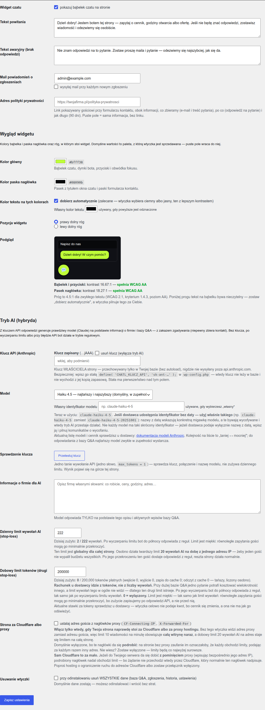
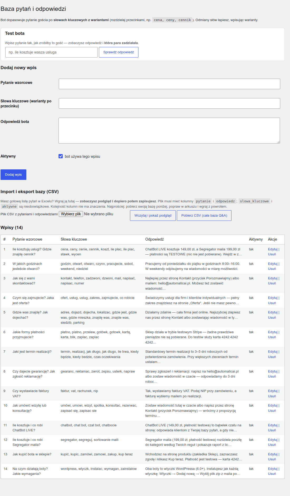
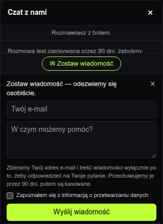
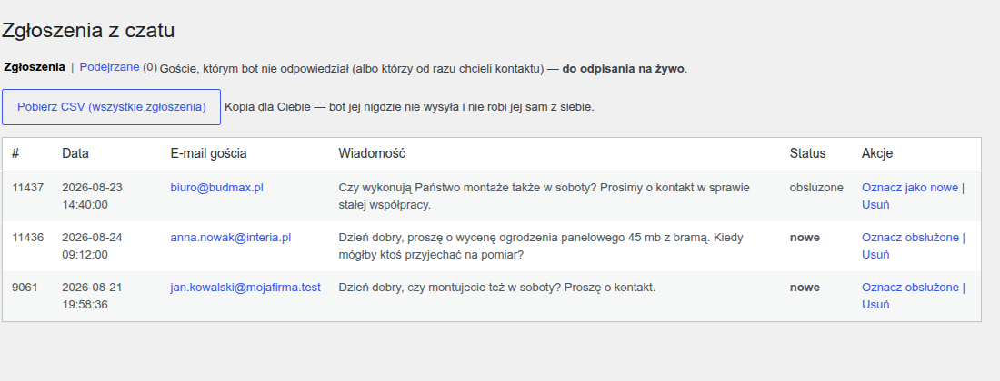
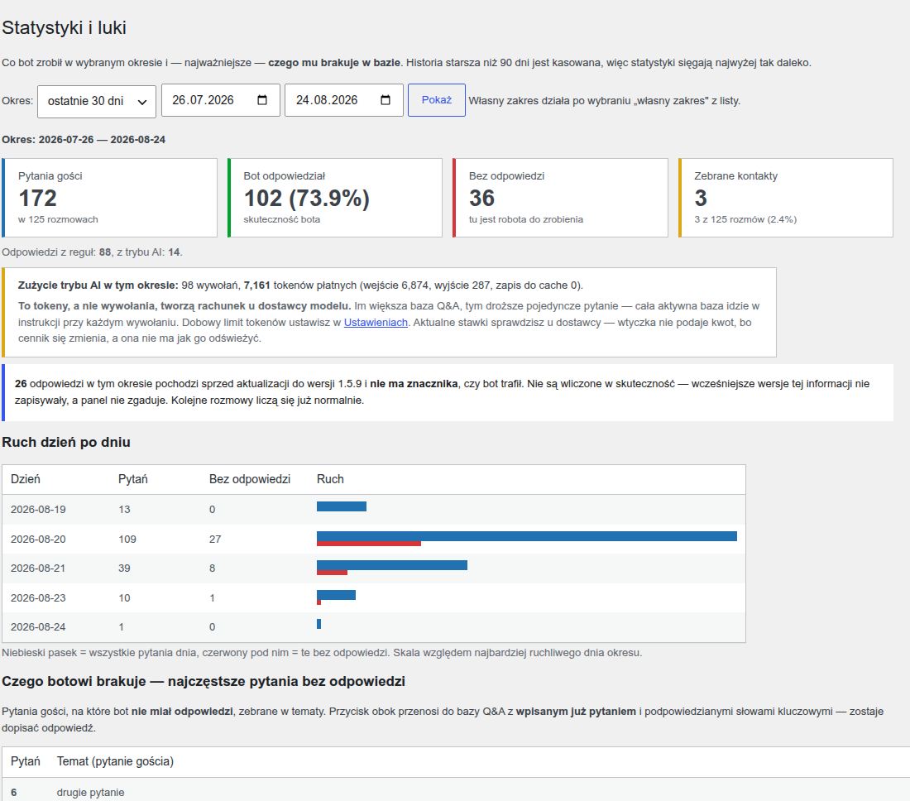

# ChatBot LIVE — instrukcja użytkownika

Bot na stronę firmową: 24/7 odpowiada na powtarzalne pytania klientów z bazy
pytań-odpowiedzi, a gdy nie zna odpowiedzi — zbiera kontakt, żeby właściciel
odezwał się osobiście.

**Uczciwie:** bez klucza API to bot regułowy z bazy Q&A + most do maila właściciela
i wtedy „LIVE" znaczy, że żywy człowiek ODPISZE na zebrany kontakt. Opcjonalnie,
z własnym kluczem API, odpowiedzi generuje prawdziwy model AI — patrz sekcja
„Tryb AI". Rozmowę **możesz też przejąć osobiście** i pisać do gościa na żywo —
patrz sekcja „Przejmij rozmowę osobiście"; bot wtedy milczy.

## 1. Instalacja (2 minuty)

1. W panelu WordPressa wejdź w **Wtyczki → Dodaj nową → Wyślij wtyczkę na serwer**.
2. Wskaż plik `chatbot-live.zip` i kliknij **Zainstaluj**, potem **Włącz**.
3. Gotowe — bot od razu działa: na stronie pojawia się bąbelek czatu, a w bazie
   jest 10 przykładowych par pytanie-odpowiedź typowej firmy usługowej
   (cennik, godziny, kontakt, dojazd, płatności, terminy, gwarancja, faktury,
   umówienie wizyty, oferta).

Wymagania: WordPress 6.0+ i PHP 8.1+.

**Podstrona „Start".** Zaraz po włączeniu wtyczki w menu **ChatBot LIVE** pojawia się
pozycja **Start** — trzy pierwsze kroki (ustaw teksty i mail, dobierz kolory i róg,
podmień bazę Q&A na swoją) z odnośnikami prosto do właściwych ekranów. Możesz ją
zamknąć na stałe, gdy przestanie być potrzebna; wraca dopiero przy nowej instalacji.

## 2. Konfiguracja w kwadrans



W menu bocznym pojawia się pozycja **ChatBot LIVE**.

1. **Ustawienia** → podmień tekst powitania i tekst awaryjny na własne,
   wpisz mail do powiadomień o zgłoszeniach (domyślnie mail administratora).
2. **Baza Q&A** → przejrzyj 10 przykładowych wpisów i podmień treści na
   dane swojej firmy (telefony, adres, ceny). Każdy wpis to:
   - *pytanie wzorcowe* — dla Ciebie, żeby wiedzieć, czego dotyczy wpis,
   - *słowa kluczowe z wariantami* — po nich bot dopasowuje pytanie gościa;
     rozdzielaj przecinkami i wpisuj odmiany oraz formy bez polskich znaków,
     np. `cena, ceny, cennik, koszt`. Sztuczka: krótki rdzeń łapie odmiany —
     `otwart` złapie „otwarte", „otwarci", „otwarta",
   - *odpowiedź bota* — to, co gość zobaczy w czacie.
3. Wejdź na swoją stronę i przetestuj: zadaj pytania, na które bot ma
   odpowiedzieć, i jedno, na które nie ma — powinien uczciwie zaproponować
   zostawienie maila.

> **Warto dodać wpis powitalny — ale to Twoja decyzja, i warto znać jej cenę.**
> Pierwsze, co pisze człowiek do czatu, to zwykle „dzień dobry" — a bot z założenia
> **nie zgaduje** i na nieznane pytanie odpowiada „nie znam odpowiedzi". Możesz to
> zmienić, dodając w **Bazie Q&A** własny wpis (przycisk *Dodaj wpis*):
>
> - **pytanie wzorcowe:** `Dzień dobry / cześć — jak zacząć?`
> - **słowa kluczowe:** `dzień dobry, dzien dobry, dobry wieczor, dobry wieczór, witam, witaj, czesc, cześć, hej, halo, siema, hello`
> - **odpowiedź:** `Dzień dobry! Zapytaj o cennik, godziny otwarcia, ofertę, dojazd albo termin realizacji — odpowiem od ręki. Jeśli czegoś nie będę wiedzieć, zostawisz wiadomość i odezwiemy się osobiście.`
>
> ⚠️ **Cena tego wpisu:** przy pytaniu, które łączy powitanie z treścią
> („**Dzień dobry, ile kosztuje wizyta?**"), bot może odpowiedzieć **powitaniem
> zamiast cennika** — dopasowanie liczy trafione warianty, a przy remisie wygrywa
> dłuższy, czyli „dzień dobry". Dlatego tego wpisu **nie ma** w bazie startowej.
> Jeśli chcesz go mieć, a zależy Ci na pytaniach złożonych, zostaw w słowach
> kluczowych **tylko krótkie** powitania (`witam, witaj, czesc, cześć, hej, halo,
> siema, hello`) — wtedy „dzień dobry" samo w sobie dalej trafi w tekst awaryjny,
> ale zagajenia z treścią pójdą do właściwej odpowiedzi. Ta sama zasada dotyczy
> podziękowań („dziękuję", „ok") — jeśli chcesz na nie odpowiadać, dodaj im
> własny wpis i sprawdź w **Teście bota**, czy nie przejmuje pytań.

### Test bota bez wychodzenia na stronę

Na stronie **Baza Q&A**, pod listą wpisów, jest sekcja **„Test bota"**. Wpisujesz
pytanie tak, jak zadałby je gość (np. „ile kosztuje wasza usługa") i od razu widzisz
odpowiedź **oraz to, KTÓRA para z bazy ją dała**. Jeśli żadna nie pasuje, dostajesz
wprost **„Żadna para nie pasuje."** — i wiesz, że trzeba dopisać słowa kluczowe.
To najszybszy sposób sprawdzenia zmiany: nie musisz odświeżać strony firmowej
ani czyścić cache.

## 2a. Baza pytań z pliku — import i eksport CSV



Jeśli masz już listę pytań w Excelu albo Arkuszach Google, nie musisz przepisywać
jej po jednym wpisie. **ChatBot LIVE → Baza Q&A**, sekcja **„Import i eksport bazy (CSV)”**.

**Kolumny.** Wymagane są dwie: `pytanie` i `odpowiedz`. Nieobowiązkowe:
`slowa_kluczowe` (rozdzielone przecinkami) i `aktywne` (`1` albo `0`; brak kolumny
albo pusta komórka znaczy „wpis ma działać”). Nagłówki mają też przyjmowane odmiany:
`pytanie_wzorcowe`, `slowa`, `warianty`, `odpowiedz_bota`, `aktywny`.
Kolumny rozpoznawane są **po nazwie w pierwszym wierszu, nie po kolejności** —
możesz je poprzestawiać. Najprościej: **najpierw wyeksportuj to, co już masz**
(przycisk **„Pobierz CSV (cała baza Q&A)”** w tej samej sekcji), popraw w arkuszu
i wgraj z powrotem
— plik eksportu ma dokładnie te kolumny, które przyjmuje import.

**Pliki z polskiego Excela działają**: rozpoznawany jest średnik jako separator,
kodowanie windows-1250, znacznik BOM i końce linii z Windows. Pusty wiersz między
danymi nie psuje importu.

**Nic nie trafia do bazy od razu.** Wybierasz plik i klikasz **„Wczytaj i pokaż
podgląd”**. Zobaczysz wtedy **ekran podglądu**: każdy
wiersz z werdyktem (do zapisania / duplikat pomijany / błąd), licznikami i polami
**słów kluczowych do poprawienia**. To ważne, bo bot dopasowuje pytanie gościa
**wyłącznie po słowach kluczowych** — wiersz bez nich byłby martwy, więc wtyczka
podpowiada je sama i pokazuje do edycji. Do bazy nic nie idzie, dopóki nie klikniesz
**„Zapisz N wpisów”**.

**Import tylko dopisuje.** Pytanie, które już jest w bazie, zostaje nietknięte,
a wiersz z pliku jest pomijany — i widać to w podglądzie. Nie da się nim przypadkiem
nadpisać własnej, poprawionej treści.

**Limity, żeby nie zaskoczyły przy większym pliku:**

| co | ile |
|---|---|
| wierszy w jednym pliku | **2000** |
| rozmiar pliku | **2 MB** |
| ważność podglądu | **15 minut** — po tym czasie wgraj plik jeszcze raz |

Krzywy plik kończy się **komunikatem**, nie białym ekranem: pusty plik, brak
wymaganych kolumn, przekroczony limit albo plik za duży dla Twojego hostingu
zostaną nazwane po imieniu.

## 3. Wygląd widgetu — dopasuj go do swojej strony


Tak widget wygląda oczami gościa — zamknięty bąbelek, otwarte okno rozmowy
i formularz zostawienia wiadomości:



Wejdź w **ChatBot LIVE → Ustawienia → Wygląd widgetu**. Ustawisz tam:

- **Kolor główny** — bąbelek czatu, dymki bota, przyciski.
- **Kolor paska nagłówka** — belka z tytułem okna.
- **Kolor tekstu na nich** — zostaw „dobierz automatycznie" (zalecane), a wtyczka
  sama wybierze ciemny albo jasny, ten czytelniejszy na Twoim tle.
- **Pozycja** — prawy albo lewy dolny róg strony.

Obok jest **podgląd na żywo**: kolory zmieniają się od razu przy wyborze, jeszcze
przed zapisem, więc widzisz dokładnie to, co zobaczy gość.

Pod podglądem stoi **kontrast**. To nie ozdoba — jeśli tekst na bąbelku ma za
mały kontrast do tła, część osób go nie przeczyta, a przy audycie dostępności
jest to pierwszy zarzut. Wtyczka liczy współczynnik według normy WCAG 2.1
i mówi wprost: „spełnia WCAG AA" albo „PONIŻEJ progu". Próg to 4,5:1.
Zapisać możesz i tak — decyzja jest Twoja, ale wiesz, co wybierasz.

> Po aktualizacji ze starszej wersji **nic Ci się nie zmieni**: domyślne kolory
> to dokładnie te, które widget miał wcześniej.

## 4. Jak to działa na co dzień



- Gość pyta → bot odpowiada z bazy Q&A (wygrywa wpis z największą liczbą
  trafionych słów kluczowych).
- Brak dopasowania → bot pokazuje tekst awaryjny i formularz „zostaw maila".
  Przycisk **„Zostaw wiadomość"** jest zresztą widoczny cały czas — gość
  zawsze ma ścieżkę do człowieka.
- Listy w panelu (zgłoszenia, historia rozmów, raport luk) są **podzielone na
  strony** — jeśli masz więcej wpisów, niż mieści jedna strona, pod tabelą pojawią
  się numery. Nic nie znika po przekroczeniu limitu.
- Zgłoszenia lądują w **ChatBot LIVE → Zgłoszenia** (+ mail do Ciebie, jeśli
  włączony). Odpisujesz osobiście — to jest człon „LIVE".
- **Historia rozmów** pokazuje wymiany bot↔gość; wpisy starsze niż **90 dni**
  są czyszczone automatycznie. Gość widzi o tym krótką notę **na starcie czatu**,
  a jeśli podałeś adres polityki prywatności w Ustawieniach — nota prowadzi
  także do niej. Warto ten adres uzupełnić: to Ty jesteś administratorem tych danych.

### Gość widzi, że bot pisze

Zanim odpowiedź się pojawi, w oknie czatu miga **sygnał „bot pisze"**. Ma znaczenie
przede wszystkim w trybie AI, gdzie odpowiedź potrafi iść kilka sekund: bez tego sygnału
gość patrzy na nieruchomy ekran i klika drugi raz, a potem trzeci. Wskaźnik jest też
czytany przez czytniki ekranu (etykieta „Bot pisze odpowiedź"), więc osoba niewidząca
dostaje tę samą informację co reszta.

### Długie listy mają strony

Trzy listy w panelu dzielą się na strony, więc nie urywają się w połowie danych:

| lista | wierszy na stronę |
|---|---|
| **Zgłoszenia z czatu** | 200 |
| **Historia rozmów** | 100 |
| **Raport luk** (Statystyki i luki) | 25 tematów |

Pod każdą listą widać, którą stronę oglądasz i ile jest wszystkich pozycji. Jeśli
kiedyś widziałeś dokładnie 200 zgłoszeń i myślałeś, że to wszystko — teraz reszta
jest o jedno kliknięcie dalej, a nie niedostępna.

### Pułapka na boty — i czego ona NIE zatrzyma

Czat jest publiczny, więc trafiają na niego automaty. Wtyczka ma na nie proste
sito: **ukryte pole**, którego człowiek nie widzi i nie dosięgnie klawiszem Tab
(wypełnia je tylko skrypt), oraz **próg czasu** — pytanie wysłane w niecałe
2 sekundy od otwarcia czatu nie jest pisane przez człowieka.

Próg czasu celowo **nie obowiązuje przy formularzu kontaktu**: gość, który otwiera
czat i od razu klika „Zostaw wiadomość", potrafi wysłać go bardzo szybko, a pomyłka
kosztowałaby Cię prawdziwy kontakt. Formularza pilnuje samo ukryte pole.

Co się dzieje ze złapaną wiadomością — i dlaczego właśnie tak:

- **Zostaje zapisana**, z oznaczeniem „podejrzane". Nie kasujemy jej po cichu,
  bo gdyby sito pomyliło się przy prawdziwym kliencie, **nikt by się o tym nie
  dowiedział**: klient myślałby, że wysłał, a Ty nie wiedziałbyś, że coś przepadło.
- **Nie dostajesz o niej maila.** To główny powód, dla którego ta pułapka
  istnieje — żeby automat nie zasypał Twojej skrzynki.
- **Nie zużywa budżetu trybu AI** ani limitu, który chroni prawdziwych gości.
- Lista **Zgłoszenia** pokazuje domyślnie tylko czyste. Podejrzane są **za
  filtrem obok, z licznikiem** — jeśli klient mówi, że pisał i nie dostał
  odpowiedzi, zajrzyj tam w pierwszej kolejności.
- Wysyłający **nie dowiaduje się, że wpadł** — widzi to samo podziękowanie co
  wszyscy. Inaczej autor skryptu poprawiłby go w pięć minut.

Liczbę zadziałań pułapki widzisz jako komunikat w panelu — z rozbiciem na te przy
**formularzu kontaktu** (te zgłoszenia są zapisane i znajdziesz je pod filtrem
„podejrzane") i te przy **pytaniach do bota** (tam nie ma czego zapisać, bo gość nie
zostawił kontaktu). Po aktualizacji wtyczki licznik startuje od zera — wcześniejsze
zgłoszenia i ich oznaczenie zostają nietknięte.

⚠️ **Uczciwie o granicy tego sita.** Pułapka zatrzymuje automaty, które
przeglądają stronę i wypełniają wszystko, co znajdą, albo strzelają natychmiast
po jej wczytaniu. **Nie zatrzyma** kogoś, kto celowo podejrzy, jak czat wysyła
dane, i będzie wysyłał je bezpośrednio, z odstępami — przed tym broni dobowy
limit zapytań AI z jednego adresu (Ustawienia → tryb AI), a nie ukryte pole.
To jest tanie sito na masową głupotę, nie zamek na determinację. Jeśli
zobaczysz, że mimo pułapki budżet AI znika, napisz do nas — wtedy potrzebne
jest inne narzędzie (np. captcha albo ograniczenie czatu do zalogowanych).

## 5. Statystyki i luki — czyli jak ulepszać bota bez zgadywania



Wejdź w **ChatBot LIVE → Statystyki i luki**. Wybierasz okres (7 / 30 / 90 dni
albo własne daty) i widzisz cztery liczby:

| Kafelek | Co znaczy |
|---|---|
| **Pytania gości** | ile pytań przyszło i w ilu rozmowach |
| **Bot odpowiedział** | ile razy bot znał odpowiedź i jaki to procent — to **skuteczność bota** |
| **Bez odpowiedzi** | ile razy musiał się przyznać, że nie wie |
| **Zebrane kontakty** | ile osób zostawiło maila i jaka to część wszystkich rozmów |

Pod spodem jest ruch dzień po dniu, a **najważniejsza jest ostatnia tabela:
„Czego botowi brakuje"**. To lista pytań, na które bot NIE umiał odpowiedzieć,
zebrana w tematy — bo goście pytają o to samo na dziesięć sposobów
(„ile kosztuje dostawa", „koszt dostawy", „jaki jest koszt dostawy" to jeden
temat). Przy każdym temacie widzisz, ile razy padł i kiedy ostatnio; klikając
**„…i N innych sformułowań"** zobaczysz, co dokładnie pisali goście.

Obok każdego tematu jest przycisk **„Dopisz odpowiedź →"**. Klikasz i lądujesz
w bazie Q&A z **już wpisanym pytaniem** i podpowiedzianymi słowami kluczowymi —
zostaje wpisać odpowiedź i zapisać. To cała pętla ulepszania bota: raz w tygodniu
zajrzyj tutaj, dopisz 2–3 odpowiedzi, a skuteczność rośnie sama.

> **Uwaga po aktualizacji ze starszej wersji:** rozmowy zapisane **przed**
> wersją 1.3.0 nie mają informacji, czy bot trafił — wtyczka jej wtedy nie
> zbierała i **nie zgaduje jej wstecz**. Zobaczysz je na stronie jako osobną
> liczbę „bez znacznika"; nie psują procentu skuteczności. Od aktualizacji
> wszystko liczy się normalnie, więc po kilku dniach ruchu statystyki są pełne.

## 6. Tryb AI (opcjonalny — hybryda)

Bez klucza bot działa w pełnoprawnym trybie regułowym. Z kluczem API
(Anthropic — klucz zdobywasz na własnym koncie na console.anthropic.com)
odpowiedzi generuje prawdziwy model na podstawie **Twojego opisu firmy**
i aktywnych wpisów bazy Q&A:

1. **Ustawienia → Tryb AI** → wklej klucz, wypełnij pole „Informacje o firmie".
2. Model ma zakaz zgadywania: gdy nie zna odpowiedzi, zbiera kontakt zamiast
   zmyślać ceny czy terminy.
2a. **Bot pamięta bieżącą rozmowę** — gość może dopytywać („jak dojechać",
   potem „gdzie zaparkować") i bot wie, o czym mowa. Pamięć obejmuje ostatnie
   6 wymian i **kończy się wraz z zamknięciem karty** przeglądarki; przy
   następnej wizycie rozmowa zaczyna się od nowa. Ucięcie jest celowe:
   każda dołożona wymiana to tokeny na Twoim rachunku.
3. **Stop-loss — DWA limity, bo rachunek idzie z tokenów, nie z wywołań:**
   dzienny limit **wywołań** (domyślnie 100) i dzienny limit **tokenów**
   (domyślnie 200 000; `0` = wyłączony). Ten drugi jest ważniejszy, niż wygląda:
   przy każdym pytaniu do modelu wysyłana jest **cała Twoja aktywna baza Q&A**,
   więc im większa baza, tym droższe pojedyncze pytanie — a limit wywołań tego
   w ogóle nie widzi. Oba liczniki (wywołania i tokeny) widzisz w Ustawieniach,
   a zużycie za wybrany okres na stronie **Statystyki i luki**.
   Obie liczby są miękkie — równoległe zapytania gości mogą je minimalnie
   przekroczyć. Osobno działa twardszy limit **20 wywołań AI na dobę
   z jednego adresu IP**, żeby jeden gość nie wypalił budżetu wszystkich.
   Wtyczka pokazuje **tokeny, nie złotówki** — aktualne stawki sprawdzisz
   u dostawcy modelu, bo cennik się zmienia, a wtyczka nie ma jak go odświeżyć.
   W pola limitów wpisuj **samą liczbę** (np. `50000`, nie „50 000" ani „50.000") —
   nieczytelną albo pustą wartość wtyczka pomija, zostawia poprzedni limit i mówi
   o tym czerwonym komunikatem zamiast „zapisano". Gdy licznik wywołań jest
   nieczytelny (błąd bazy danych), tryb AI jest wstrzymany i bot odpowiada
   z reguł — zobaczysz to w Ustawieniach i w czerwonym pasku u góry panelu.
   Po wyczerpaniu któregokolwiek limitu, przy błędzie API albo braku klucza bot
   automatycznie wraca do trybu regułowego — czat nigdy nie przestaje działać.

Koszty API ponosi właściciel klucza według cennika dostawcy.

### Klucz w konfiguracji serwera (zalecane)

Klucz wpisany w panelu leży w bazie danych — a więc wychodzi z każdą jej kopią
zapasową i przy przenoszeniu strony na inny serwer. Bezpieczniej podać go
**poza bazą**, stałą w pliku `wp-config.php`:

```php
define( 'CHATL_KLUCZ_API', 'sk-ant-…' );
```

Stała **ma pierwszeństwo** nad polem w panelu. Wtyczka pokazuje wtedy
„Klucz podany w konfiguracji serwera", a pole jest zablokowane — żeby zmienić
albo wyłączyć klucz, poprawiasz `wp-config.php`.

> Dlaczego wtyczka nie szyfruje klucza w bazie? Bo klucz szyfrujący musiałby
> leżeć w tym samym WordPressie, obok danych — kto ma bazę, ma jedno i drugie.
> To wyglądałoby na zabezpieczenie, nie będąc nim. Trzymanie klucza poza bazą
> jest realną poprawą, a nie pozorem.

## 7. FAQ

**Skąd mam wiedzieć, czy tryb AI naprawdę działa?**
W **Ustawieniach → Tryb AI** jest przycisk **„Przetestuj klucz"** — jedno tanie
wywołanie, wynik od razu na ekranie. Gdyby API zaczęło odrzucać żądania (zły albo
wygasły klucz), w panelu pojawi się czerwony pasek z datą i kodem błędu. Bot działa
wtedy dalej, ale wyłącznie z reguł — dlatego ten sygnał jest ważny.
**Goście piszą, że czat nie działa, a w panelu mam czerwone ostrzeżenie.**
Twoja strona jest podawana z pamięci podręcznej (cache) starszej niż ważność
zabezpieczenia formularza — to najczęstsza przyczyna. Wtyczka próbuje ratować
rozmowę sama: odświeża zabezpieczenie i powtarza pytanie. Jeśli mimo to liczba
w ostrzeżeniu rośnie, **wyłącz cache dla strony z czatem** (w LiteSpeed, WP Rocket,
W3TC albo Cloudflare) albo skróć czas życia cache.

**Zmieniłem kolory i tekst zrobił się nieczytelny.**
Zaznacz „dobierz automatycznie" przy kolorze tekstu — wtyczka wybierze wersję
z lepszym kontrastem. Jeśli wolisz własny kolor, patrz na odczyt kontrastu pod
podglądem: ma być co najmniej 4,5:1.

**Bot nie łapie pytania, choć wpis jest w bazie.**
Dodaj do wpisu więcej wariantów słów kluczowych (odmiany, formy bez polskich
znaków). Dopasowanie szuka fragmentów tekstu — `płatnoś` nie złapie „platnosc".

**Którym modelem odpowiada bot i czy mogę go zmienić?**
Tak — w **Ustawieniach → Tryb AI** jest pole **Model**. Domyślny (najtańszy)
w zupełności wystarcza do odpowiadania z bazy Q&A; mocniejsze kosztują więcej.
Aktualną listę modeli i cennik sprawdzisz u dostawcy, w dokumentacji Anthropic —
odnośnik jest przy tym polu. **Jeśli dostawca podaje nazwę bez daty — wpisz
właśnie taką** (`claude-haiku-4-5` zamiast `claude-haiku-4-5-20251001`): nazwy
z datą wskazują konkretną wersję modelu, a te bywają wycofywane i wtedy tryb AI
przestaje działać. Nie każdy model ma skróconą nazwę — jeżeli dostawca podaje
wyłącznie wersję z datą, wpisz ją. Gdyby model przestał istnieć, panel powie
o tym wprost („API nie zna tego modelu"), zamiast po cichu zjeżdżać do reguł.

**Skąd mam wiedzieć, czego dopisać do bazy?**
Nie zgaduj — wejdź w **Statystyki i luki**. Tabela „Czego botowi brakuje"
pokazuje prawdziwe pytania Twoich klientów, na które bot nie umiał odpowiedzieć,
uszeregowane od najczęstszych. Zacznij od góry listy.

**Statystyki pokazują „—" zamiast procentu skuteczności.**
To znaczy, że w wybranym okresie nie ma jeszcze ani jednej zmierzonej odpowiedzi
(świeża instalacja albo same rozmowy sprzed aktualizacji). Kreska, a nie „0%",
bo „nie mierzono" to co innego niż „bot nie odpowiedział ani razu".

**Czy dwa różne pytania mogą wpaść do jednego tematu?**
Tak, jeśli mają wspólne rdzenie słów — grupowanie jest po to, żeby lista miała
kilkanaście pozycji, a nie kilkaset. Zawsze możesz rozwinąć „inne sformułowania"
i sprawdzić, co dokładnie do tematu wpadło.

**Moja strona stoi za Cloudflare — czy muszę coś ustawić?**
Tak, jedną rzecz. Wejdź w **Ustawienia** i zaznacz **„Strona za Cloudflare albo
proxy"**. Bez tego wtyczka widzi adres Cloudflare zamiast adresu gościa, więc limit
10 wiadomości na minutę obowiązuje **wszystkich gości razem**, a dobowy limit
wywołań AI na adres staje się limitem na całą stronę. Jeśli nie jesteś pewien,
czy stoisz za proxy — zostaw wyłączone; limity będą wtedy co najwyżej surowsze,
a włączenie tego na stronie bez proxy pozwoliłoby je obchodzić.
Uwaga: samo używanie Cloudflare nie wystarczy. Jeżeli do Twojego serwera da się
połączyć **z pominięciem** proxy (po jego własnym adresie IP), ktoś może podać
zmyślony nagłówek i limit dalej da się obejść — bo takie żądanie nie przechodzi
przez Cloudflare, który normalnie ten nagłówek poprawia. Poproś hosting, żeby
ograniczył ruch do adresów Cloudflare, albo zostaw przełącznik wyłączony.

**Czy gość może zalać mnie wiadomościami?**
Nie — limit to 10 wiadomości na minutę z jednego adresu IP (dotyczy pytań
i zgłoszeń łącznie). Pytanie ma maks. 500 znaków, wiadomość zgłoszenia 2000.

**Nie przychodzą maile o zgłoszeniach.**
Zgłoszenia i tak zapisują się w panelu. Mail wymaga działającej wysyłki
w WordPressie — jeśli nie działa, skonfiguruj wtyczkę SMTP u swojego hostingu.

**Przejmij rozmowę osobiście**

W panelu jest podstrona **ChatBot LIVE → Rozmowy na żywo**: lista rozmów, które
toczą się w tej chwili, wraz z tym, co gość napisał. Przycisk **Przejmij** oddaje
rozmowę Tobie — gość widzi „Do rozmowy dołączył konsultant…", a **bot od tej chwili
milczy**: pytania gościa są zapisywane, żebyś je przeczytał, ale automat nie wpada
Ci w słowo (i nie zużywa limitu AI). Przycisk **Zakończ** oddaje rozmowę botowi.
Jeśli nie odpiszesz przez **5 minut**, rozmowa wraca do bota sama, a gość dostaje
komunikat „Konsultant nie odpowiada…" — po to, żeby nikt nie został przy milczącym
oknie.

**Czy bot pamięta rozmowę między wizytami?**
Nie — sesja czatu żyje w karcie przeglądarki gościa. Historia rozmów jest
zapisywana po stronie serwera (90 dni) do wglądu właściciela.

**Chcę zachować rozmowy dłużej niż 90 dni.**
Na liście zgłoszeń i w historii rozmów jest przycisk **„Pobierz CSV"** — plik
zapisuje się na Twoim komputerze i od tej chwili to Ty za niego odpowiadasz.
Wtyczka **nie** robi takiej kopii sama przed kasowaniem: gdyby robiła, zdanie
„kasujemy po 90 dniach" przestałoby być prawdą — dane byłyby tylko przenoszone
gdzie indziej. Plik ma BOM UTF-8, więc polskie znaki otwierają się poprawnie
także w Excelu.

**Co się stanie z danymi po odinstalowaniu?**
Klucz API zapisany w panelu jest kasowany przy KAŻDYM odinstalowaniu (wtyczka
nie zostawia Twojego sekretu w bazie; po ponownej instalacji wpisz go na nowo).
Klucz podany stałą w `wp-config.php` zostaje tam, gdzie go wpisałeś — wtyczka
nie rusza plików konfiguracyjnych; usuwasz go sam, jeśli chcesz. Reszta
domyślnie zostaje (możesz wrócić bez strat). Jeśli w ustawieniach zaznaczysz
„usuń wszystkie dane", odinstalowanie skasuje też bazę Q&A, zgłoszenia,
historię i ustawienia.

## 8. Droga rozbudowy (po zakupie, na życzenie)

- automatyczne łapanie polskich odmian (stemming) zamiast ręcznych wariantów,
- powiadomienia push o nowej rozmowie (samo przejęcie rozmowy przez człowieka
  **już jest w produkcie** — sekcja „Przejmij rozmowę osobiście"),
- pamięć rozmowy między wizytami,
- inne modele AI lub własny serwer proxy (wtyczka ma filtry `chatl_ai_url`
  i `chatl_ai_model` dla integratorów).

## 9. Deklaracja prywatności (ważne — RODO)

- **Tryb regułowy:** treść rozmów NIE opuszcza Twojego WordPressa — dopasowanie
  działa lokalnie, dane (rozmowy, zgłoszenia z mailami gości) leżą w Twojej bazie.
- **Tryb AI:** do API dostawcy modelu (Anthropic) wychodzą **cztery** rzeczy:
  treść pytania gościa, Twój opis firmy, Twoja baza Q&A oraz **do 6 wcześniejszych
  wymian tej samej rozmowy**. Ta czwarta pozycja jest po to, żeby bot rozumiał
  dopytanie („a gdzie zaparkować?"), ale znaczy też, że **wszystko, co w tej
  rozmowie już napisano**, wychodzi razem z kolejnym pytaniem — i nie chodzi tylko
  o gościa. Wcześniejsze wymiany to **wszystkie** wiersze rozmowy:
  wiadomości gościa (imię, nazwisko, numer telefonu, jeśli je podał),
  odpowiedzi bota, **wiadomości Twojego konsultanta z okresu, gdy przejął rozmowę**,
  oraz komunikaty systemowe („do rozmowy dołączył konsultant"). Jeśli konsultant
  napisał w czacie coś, czego nie chcesz wysyłać na zewnątrz, a rozmowa wróciła
  potem do bota — ta treść pojedzie do dostawcy przy następnym pytaniu gościa.
  Napisz o tym w swojej polityce prywatności; poza tą listą nic z rozmowy nie
  opuszcza Twojego WordPressa.
- W obu trybach zbierasz maile gości (zgłoszenia) i przechowujesz historię
  rozmów 90 dni — **dopisz to do polityki prywatności swojej strony** wraz
  z informacją o dostawcy AI, jeśli włączasz tryb AI.
