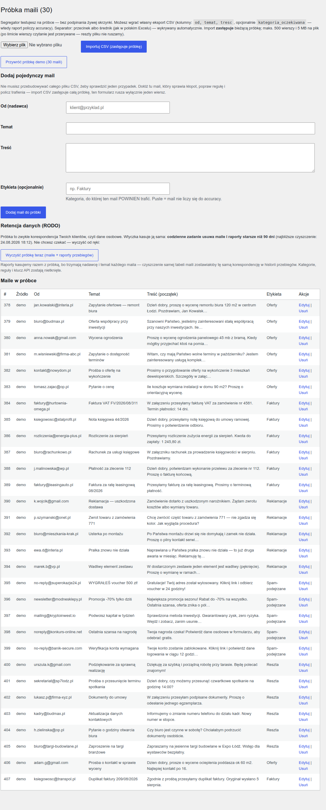
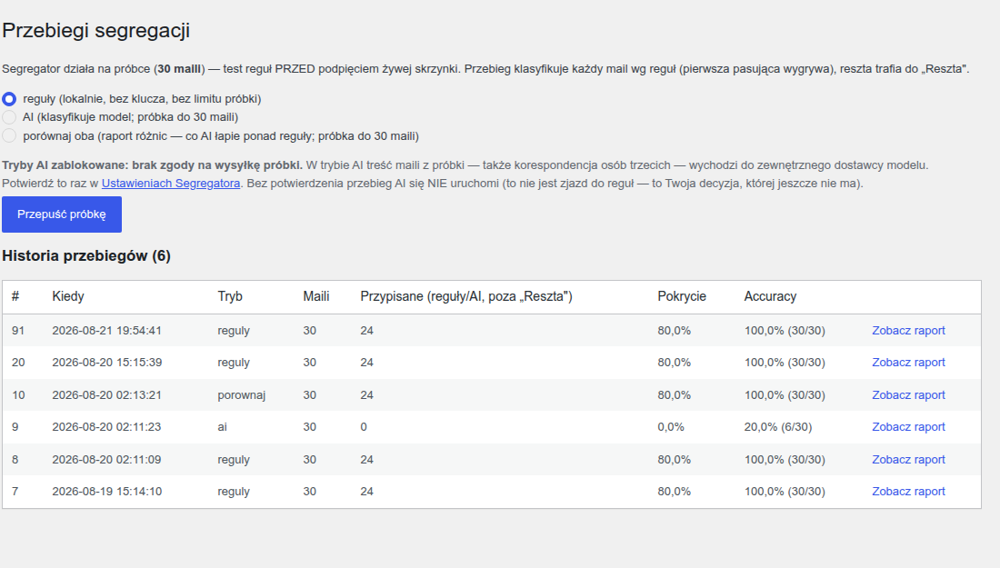
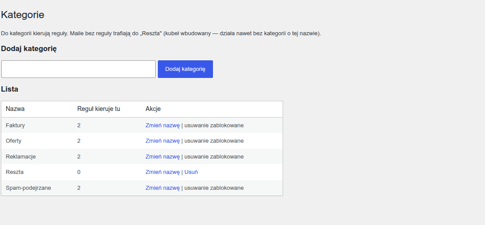
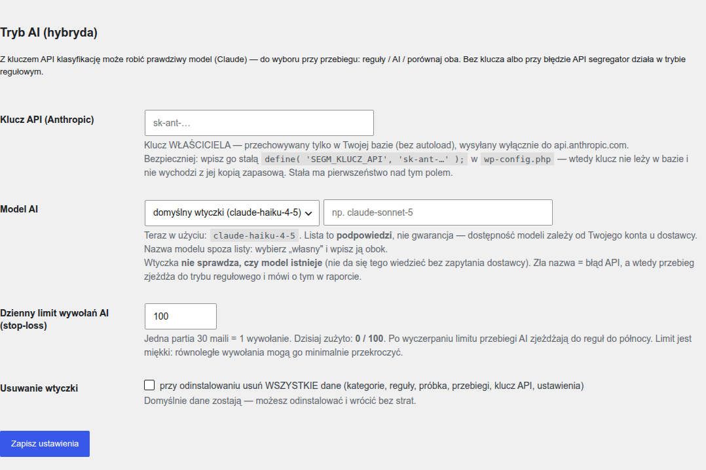
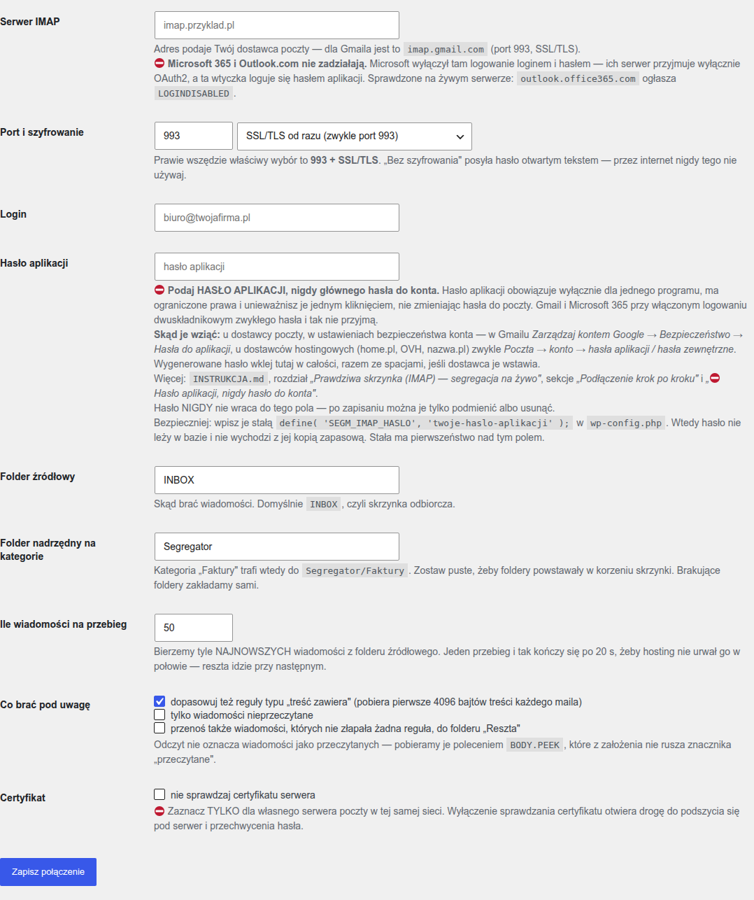

# Segregator maila — instrukcja użytkownika

Porządkuje firmową skrzynkę: rozdziela pocztę do kategorii według Twoich reguł
(jak filtry Gmaila) i pokazuje raport z liczbami — ile roboty automat zdejmuje
z Ciebie i gdzie się myli.

**Jak to działa:** najpierw ustawiasz reguły i sprawdzasz je na PRÓBCE maili
(wbudowane demo albo Twój eksport CSV) — czyli ZANIM cokolwiek dotknie
prawdziwej poczty. Potem podłączasz skrzynkę po IMAP (rozdział 6) i wtyczka
rozkłada pocztę do folderów sama. **Domyślnie na sucho**: pokazuje, co by
przeniosła, i nie rusza ani jednej wiadomości, dopóki sam tego nie włączysz.
Gotowe reguły możesz też wyeksportować do filtrów Gmaila i Outlooka.

## 1. Instalacja (2 minuty)

1. **Wtyczki → Dodaj nową → Wyślij wtyczkę na serwer** → wskaż
   `segregator-maila.zip` → **Zainstaluj** → **Włącz**.
2. Gotowe — od razu masz: 5 kategorii (Oferty, Faktury, Reklamacje,
   Spam-podejrzane, Reszta), 8 przykładowych reguł i próbkę 30 polskich maili
   demo z etykietami.
3. Po włączeniu wtyczka pokaże **ekran powitalny** z trzema pierwszymi krokami.
   Możesz go zamknąć na stałe — nie wraca.

Wymagania: WordPress 6.0+ i PHP 8.1+.

## 2. Pierwszy przebieg (1 minuta)


Ekran **Próbka maili** — 30 wbudowanych maili demo, na których uczysz reguły:



Sam przebieg uruchamiasz na ekranie **Przebiegi** — tam jest przycisk „Przepuść próbkę" i raport trafień:



1. W menu bocznym: **Segregator maila → Przebiegi**.
2. Kliknij **„Przepuść próbkę"** (tryb „reguły").
3. Dostajesz raport: mail → kategoria → która reguła zadziałała, trafienia
   per kategoria, **% pokrycia** (ile skrzynki automat rozdziela sam) oraz —
   bo próbka demo ma etykiety — **ACCURACY** (% trafień) z listą pomyłek.
   Raport możesz pobrać jako CSV.

## 3. Reguły pod własną firmę w ~20 minut




1. **Kategorie** → dodaj/zmień kategorie pod swoją skrzynkę.
2. **Reguły** → każda reguła to: *warunek* (nadawca / temat / treść ZAWIERA
   któryś z wariantów po przecinku, np. `faktur, rachunek`) → *kategoria*.
   **Kolejność na liście rozstrzyga: pierwsza pasująca reguła wygrywa** —
   przesuwaj strzałkami ▲▼. Reguły szczegółowe dawaj wyżej, ogólne niżej.
3. **Próbka maili** → wgraj własny eksport z CSV (kolumny: `od, temat, tresc`,
   opcjonalnie `kategoria_oczekiwana`; maks. 500 wierszy; import zastępuje
   próbkę — przycisk obok przywraca demo). Jeśli dodasz kolumnę
   `kategoria_oczekiwana` z ręcznie przypisanymi kategoriami, raport policzy
   accuracy i pokaże, GDZIE reguły się mylą.
4. Kręć pętlę: przebieg → zobacz pomyłki → popraw reguły → przebieg. Mail bez
   żadnej reguły trafia do kubła **„Reszta"** (jak mail zostający w skrzynce
   głównej Gmaila).

**Nie musisz puszczać całej próbki, żeby sprawdzić jedną regułę.** Przy każdej
regule na liście są dwie liczby z bieżącej próbki:

- **Pasuje** — do ilu maili pasuje sam wzorzec, gdyby ta reguła była jedyna,
- **Zgarnia** — ile z nich reguła realnie bierze, bo wcześniejsza mogła je
  zabrać pierwsza.

Reguła, która pasuje do dwudziestu maili i zgarnia zero, to najczęstsza
przyczyna wrażenia „reguła wygląda dobrze, a nic nie łapie" — stoi za nisko.
Przycisk **„Policz na próbce (bez zapisywania)"** liczy to samo dla wzorca,
którego jeszcze nie zapisałeś, więc możesz próbować bez zaśmiecania listy.

Na stronie *Próbka maili* możesz też **dodać, poprawić albo usunąć POJEDYNCZY
mail** — bez przebudowywania całego pliku CSV, gdy chcesz sprawdzić jeden
uparty przypadek. Długie listy (przebiegi, próbka, historia skrzynki) są
dzielone po **50 wierszy** na stronę, z informacją „pozycje X–Y z Z".

### Przeprowadzka: zabierz reguły ze sobą

Na dole strony **Reguły** jest sekcja *„Przeprowadzka"*: **pobierasz plik JSON**
z kategoriami i regułami, a na drugiej instalacji wczytujesz go jednym
przyciskiem. Przydaje się przy przenoszeniu strony, drugim oddziale albo
zwyczajnej kopii bezpieczeństwa własnej konfiguracji.

Co trzeba wiedzieć, zanim wczytasz:

- wczytanie **ZASTĘPUJE wszystkie reguły**, a kategorie tylko **uzupełnia** —
  żadna istniejąca kategoria nie znika (mogą do niej kierować raporty i foldery
  na skrzynce),
- reguły wiążą się z kategorią **po nazwie**, nie po numerze, więc działają na
  instalacji, gdzie kategorie mają inne identyfikatory,
- ⛔ **w pliku NIE MA sekretów ani cudzej poczty**: hasła do skrzynki, klucza
  API, próbki maili, historii przebiegów ani zapisanych zgód. Plik ląduje
  w katalogu pobranych, więc świadomie nie wkładamy tam niczego wrażliwego —
  po przeprowadzce hasło, klucz i zgody podajesz na nowo,
- limity wczytywanego pliku: **512 kB**, **500 kategorii i 500 reguł**, wzorzec
  do **2000 znaków** — plik z zewnątrz jest traktowany jak dane od nieznajomego
  i sprawdzany, zanim cokolwiek trafi do bazy,
- po wczytaniu **sprawdź kolejność reguł** — to ona rozstrzyga, która wygrywa.

## 4. Tryb AI (opcjonalny — hybryda)



**Najpierw zgoda — bez niej tryby AI się nie uruchomią.** W trybie AI nadawca,
temat i treść każdego maila z próbki wychodzą z Twojego serwera do zewnętrznego
dostawcy modelu, a próbka to zwykle korespondencja Twoich klientów, czyli CUDZE
dane osobowe. Dlatego w **Ustawieniach Segregatora** jest sekcja *„Zgoda na
wysyłkę próbki do AI"*: jedno wyraźne potwierdzenie, zapisane z datą i loginem
(do okazania, gdyby ktoś zapytał, kto na to pozwolił). Zgodę można cofnąć
jednym przyciskiem — wtedy tryby AI znów są zablokowane, a próbka, reguły i
raporty zostają nietknięte. Tryb „reguły" działa lokalnie i zgody nie wymaga.

Z własnym kluczem API (Anthropic, console.anthropic.com) klasyfikację może
robić prawdziwy model — a najciekawszy jest tryb **„porównaj oba"**:

- raport pokazuje różnice per mail (reguły vs AI), liczbę zgodnych/różnych
  oraz accuracy OBU silników — widać czarno na białym, co AI łapie ponad
  Twoje reguły (np. niuans w treści bez słowa kluczowego),
- model dostaje listę TWOICH kategorii i ma niepewne maile odkładać do „Reszta",
- **limit próbki w trybach AI: 30 maili** (jedno wywołanie API na przebieg —
  tak dobrane, żeby przebieg zawsze mieścił się w limicie czasu żądania
  typowego hostingu); większa próbka = czytelny komunikat i podpowiedź:
  zmniejsz próbkę albo użyj trybu regułowego (ten limitu nie ma),
- **stop-loss:** jedna partia do 30 maili = 1 wywołanie API; dzienny limit
  wywołań (domyślnie 100, miękki — równoległe wywołania mogą go minimalnie
  przekroczyć) z licznikiem w ustawieniach; przy błędzie API, braku klucza
  albo wyczerpanym limicie przebieg automatycznie wykonuje się regułami
  (z komunikatem).

### Klucz API: gdzie go trzymać i jak sprawdzić, czy działa

Klucz wpisujesz w **Ustawieniach Segregatora**. Bezpieczniej niż w bazie —
**stałą w `wp-config.php`**:

```php
define( 'SEGM_KLUCZ_API', 'sk-ant-...' );
```

Stała ma **pierwszeństwo** nad polem w panelu (pole jest wtedy zablokowane,
a panel pokazuje cztery ostatnie znaki, żebyś wiedział, który klucz działa).
Klucz nie leży wtedy w bazie, więc nie wychodzi z jej kopią zapasową ani
z eksportem na środowisko testowe. Dokładnie tak samo rozwiązane jest hasło do
skrzynki (`SEGM_IMAP_HASLO`) i klucz w ChatBocie — jeden sposób dla obu botów.

Przycisk **„Przetestuj klucz API"** wysyła JEDNO wywołanie ze słowem „ping" —
żadnego maila z próbki, żadnej Twojej treści. Odpowiedź mówi wprost, czy klucz
działa i którym modelem odpowiedział. Test **nie zabiera jednostki z dziennego
limitu** i nie jest nim blokowany: sprawdzenie własnych poświadczeń musi działać
także wtedy, gdy limit jest wyczerpany.

Gdy dostawca odrzuci wywołanie, przebieg zjeżdża do reguł i kończy się wynikiem
— ale na stronach wtyczki zapala się **pasek „tryb AI nie działa"** z datą,
kodem i tym, co dokładnie odpowiedział dostawca, po polsku. Bez tego paska
wtyczka mogłaby miesiącami „działać w trybie AI", licząc wyłącznie regułami.
Pasek gaśnie **sam** po pierwszym udanym wywołaniu.

### Wybór modelu

W Ustawieniach wybierasz model z listy podpowiedzi (Haiku — najtańszy
i domyślny, Sonnet, Opus) albo wpisujesz **własną nazwę**, jeśli masz dostęp do
innego modelu. Domyślny jest `claude-haiku-4-5` — **alias bez daty**, celowo:
identyfikatory z datą wskazują konkretną migawkę modelu, a te bywają wycofywane.

Lista to **podpowiedzi, nie gwarancja** — dostępność zależy od Twojego konta
u dostawcy. Wtyczka nie sprawdza, czy model istnieje (tego nie da się wiedzieć
bez zapytania dostawcy); zła nazwa skończy się błędem API, a wtedy zobaczysz to
na pasku i przebieg policzy regułami. Nazwa z literówką jest odrzucana przy
zapisie i zostaje poprzednia — żeby pomyłka w formularzu nie wyłączyła po cichu
trybu AI przy następnym przebiegu.

Koszty API ponosi właściciel klucza według cennika dostawcy.

## 5. Eksport filtrów do prawdziwej skrzynki


Kiedy reguły dają na próbce wynik, który Cię zadowala, przenieś je tam, gdzie
naprawdę stoi poczta: **Segregator maila → Eksport filtrów**.

Do wyboru trzy pliki:

- **Gmail — plik XML do zaimportowania.** W Gmailu: *Ustawienia → Zobacz
  wszystkie ustawienia → Filtry i zablokowane adresy → Importuj filtry*.
- **Gmail — zapytania do wklejenia (CSV).** Ta sama treść, ale do ręcznego
  sprawdzenia: wklejasz zapytanie w wyszukiwarkę Gmaila i widzisz, co złapie,
  ZANIM cokolwiek zaimportujesz. Zalecane pierwsze podejście.
- **Outlook — instrukcja krok po kroku (TXT).** Outlook nie przyjmuje reguł
  z zewnętrznego pliku (jego własny format `.rwz` otwiera wyłącznie klasyczny
  Outlook, a w wersji przeglądarkowej import w ogóle nie działa), więc
  dostajesz listę do odklikania — w naszej kolejności.

### Czego eksport NIE przeniesie — przeczytaj, zanim zaimportujesz

1. **Kubeł „Reszta" nie jest eksportowalny.** To nie reguła, tylko „żadna
   reguła nie pasowała", a takiego warunku nie ma ani Gmail, ani Outlook.
   Skutek w skrzynce wychodzi jednak ten sam: mail, którego nie złapie żaden
   filtr, zostaje w Skrzynce odbiorczej.
2. **Kolejność.** Nasz silnik zatrzymuje się na PIERWSZEJ pasującej regule;
   Gmail czegoś takiego nie ma. Dlatego w eksporcie **każdy filtr dostaje
   dodatkowy warunek wykluczający wszystkie wcześniejsze reguły** — dzięki temu
   mail wpada najwyżej do jednej kategorii, niezależnie od kolejności
   stosowania filtrów. W **Outlooku** odwzorowanie jest pełne: zaznacz
   w każdej regule **„Zatrzymaj przetwarzanie kolejnych reguł"**.
3. **Fragment kontra całe słowo.** My szukamy fragmentu (`faktur` łapie
   „faktury"), wyszukiwarka skrzynki operuje na słowach. To największe źródło
   różnic — wzorce urwane w połowie słowa dopisz do pełnych form.
4. **Accuracy zostaje u nas.** Skrzynka nie zna kolumny `kategoria_oczekiwana`.

Te same ostrzeżenia są wpisane w KAŻDY wygenerowany plik, żeby nie zgubiły się
po drodze do osoby, która będzie klikać w skrzynce.

## 6. Prawdziwa skrzynka (IMAP) — segregacja na żywo


Formularz połączenia ze skrzynką — pola opisane krok po kroku:



Zakładka **Segregator maila → Skrzynka (IMAP)**. Wtyczka loguje się do Twojej
skrzynki, czyta wiadomości i przenosi je do folderów na serwerze poczty —
według tych samych reguł, które przetestowałeś na próbce.

### ⭐ Domyślnie działa NA SUCHO i to jest celowe

Po podłączeniu skrzynki wtyczka **niczego nie rusza**. Przebieg pokazuje
listę: która wiadomość, od kogo, do którego folderu **by trafiła** — i tyle.
To nie jest deklaracja w regulaminie, tylko sposób działania: w trybie na
sucho folder otwierany jest poleceniem IMAP `EXAMINE`, czyli **tylko do
odczytu na poziomie protokołu**. Serwer poczty sam odrzuciłby próbę zmiany,
nawet gdyby wtyczka ją wysłała.

Realne przenoszenie włącza się **dwoma świadomymi krokami**:

1. potwierdzasz jednorazowo, że wtyczka może ruszać wiadomości (zapisujemy
   datę i login — do okazania, gdyby ktoś pytał, kto na to pozwolił),
2. dopiero potem przełączasz *Tryb pracy* na „realne przenoszenie".

Sam pierwszy krok jeszcze niczego nie włącza. Cofnięcie potwierdzenia wraca
do trybu na sucho natychmiast.

### Podłączenie krok po kroku

1. **Wygeneruj hasło aplikacji** u swojego dostawcy poczty (w Gmailu:
   *Zarządzaj kontem Google → Bezpieczeństwo → Hasła do aplikacji*). Zwykłe
   hasło do konta nie zadziała — patrz niżej.
2. **Wpisz dane połączenia** w zakładce *Skrzynka (IMAP)*: serwer, port
   i szyfrowanie, login, hasło aplikacji, folder źródłowy i folder nadrzędny
   (tabela niżej). Zapisz.
3. **Kliknij „Sprawdź połączenie".** Wtyczka naprawdę się loguje i mówi, ile
   wiadomości widzi oraz jakie foldery zastała. Dopiero gdy to działa, ma sens
   iść dalej.
4. **Puść przebieg NA SUCHO** przyciskiem *Uruchom teraz*. Nic się nie ruszy —
   dostajesz listę: która wiadomość, od kogo, do którego folderu **by trafiła**.
5. **Przeczytaj tę listę uważnie.** To jest moment na poprawianie reguł, nie
   po przeniesieniu poczty. Wróć do rozdziału 3, popraw, puść na sucho jeszcze
   raz.
6. Gdy lista wygląda tak, jak chcesz: **potwierdź jednorazowo**, że wtyczka może
   ruszać wiadomości, a **potem** przełącz *Tryb pracy* na „realne przenoszenie".
   Dwa osobne kroki — pierwszy sam z siebie niczego nie włącza.
7. Na koniec ustaw **harmonogram** (np. co 30 minut), jeśli chcesz, żeby
   segregacja chodziła sama.

### Co wpisać w polach

| Pole | Co wpisać |
|---|---|
| Serwer IMAP | adres od dostawcy poczty; dla Gmaila `imap.gmail.com` |
| Port i szyfrowanie | prawie zawsze **993 + SSL/TLS** |
| Login | zwykle pełny adres e-mail |
| Hasło | **hasło aplikacji** — patrz niżej |
| Folder źródłowy | `INBOX`, czyli skrzynka odbiorcza |
| Folder nadrzędny | np. `Segregator` — kategoria „Faktury" trafi do `Segregator/Faktury` |

Przycisk **Sprawdź połączenie** łączy się naprawdę: loguje się, mówi, ile
wiadomości widzi w folderze źródłowym, wypisuje foldery na serwerze i pokazuje
całą rozmowę z serwerem do wglądu. Hasła w tej rozmowie nie ma — w miejscu
hasła jest `****`.

### ⛔ Hasło aplikacji, nigdy hasło do konta

**Podawaj wyłącznie hasło aplikacji.** To osobne hasło wydawane jednemu
programowi: unieważnisz je jednym kliknięciem, nie zmieniając hasła do poczty,
i nie daje dostępu do reszty konta. U dostawców z logowaniem dwuskładnikowym
zwykłe hasło i tak nie zadziała.

Bezpieczniej niż w bazie — **stałą w `wp-config.php`**:

```php
define( 'SEGM_IMAP_HASLO', 'twoje-haslo-aplikacji' );
```

Stała ma **pierwszeństwo** nad polem w panelu (pole jest wtedy zablokowane).
Hasło nie leży w bazie, więc nie wychodzi z jej kopią zapasową ani z eksportem
na środowisko testowe. Tak samo rozwiązany jest klucz API w ChatBocie.

Niezależnie od tego, gdzie trzymasz hasło: **hasło nigdy nie wraca do
formularza** (można je tylko podmienić albo usunąć), a **odinstalowanie wtyczki
kasuje je z bazy ZAWSZE** — także wtedy, gdy nie zaznaczysz „usuń wszystkie
dane". To samo dotyczy potwierdzenia realnego przenoszenia.

### ⛔ Czego wtyczka nie obsłuży

**Microsoft 365 i Outlook.com.** Microsoft wyłączył tam logowanie loginem
i hasłem — ich serwer przyjmuje wyłącznie OAuth2. Sprawdzone na żywym
serwerze: `outlook.office365.com` ogłasza `LOGINDISABLED`. Wtyczka wykryje to
i powie wprost, zamiast w kółko zgłaszać „błędne hasło".

### Czego wtyczka NIE wymaga: rozszerzenia PHP „imap"

Rozszerzenie `imap` zostało wyjęte z PHP i przeniesione do repozytorium PECL —
podręcznik PHP pisze wprost: *„This extension has been moved to the PECL
repository and is no longer bundled with PHP as of PHP 8.4.0"*. Wtyczka oparta
na funkcjach `imap_*` przestałaby działać po aktualizacji PHP na Twoim
hostingu. Ta ma **własnego klienta IMAP** i potrzebuje tylko tego, co PHP ma
zawsze: gniazd sieciowych i OpenSSL. Sekcja *„Czy ten serwer to udźwignie"* na
górze zakładki sprawdza to wszystko i mówi po polsku, czego brakuje.

### Segregacja cykliczna i „Uruchom teraz"

Częstotliwość: co 15 minut, co 30 minut, co godzinę, co 6 godzin, raz na dobę
albo wyłączona. Zadanie chodzi na WP-Cron WordPressa. Jeśli WP-Cron jest
wyłączony (stała `DISABLE_WP_CRON`), wtyczka to pokaże, zamiast udawać, że
harmonogram działa. Przycisk **Uruchom teraz** działa zawsze i w tym samym
trybie, który masz ustawiony.

Jeden przebieg bierze do 50 najnowszych wiadomości (do zmiany w ustawieniach)
i kończy się po 20 sekundach — reszta idzie następnym razem. To celowe:
hosting nie urwie żądania w połowie przenoszenia.

### Historia i cofanie ostatniego przebiegu

Każdy przebieg zapisuje: co, kiedy i dokąd — i robi to **zanim** ruszy
wiadomość: najpierw wpis w historii, potem przeniesienie, na końcu potwierdzenie.
Gdyby baza danych odmówiła zapisu w trakcie, wtyczka nie rusza tej wiadomości,
przerywa przebieg i mówi o tym czerwonym komunikatem — nie zostaniesz z pocztą
rozłożoną po folderach bez zapisu, co gdzie poszło.

**Cofnij ostatni przebieg** przenosi wiadomości z powrotem do folderu, z którego
wyszły. Wtyczka zapamiętuje nowy identyfikator każdej wiadomości (kod odpowiedzi
`COPYUID`) razem z identyfikatorem folderu (`UIDVALIDITY`), a gdy serwer go nie
poda, szuka wiadomości po nagłówku `Message-ID`. Liczy tylko wiadomości, które
**naprawdę** wróciły: jeśli którąś w międzyczasie przeciągnąłeś ręcznie gdzie
indziej albo skasowałeś folder kategorii, powie tego wprost przy tej pozycji —
zamiast zgadywać i przenieść cudzy mail — a przebieg zostanie do cofnięcia
ponownie, gdy ją odnajdziesz.

Cofnąć da się **ostatni** przebieg, nie dowolny wcześniejszy. Dlatego zanim
włączysz realne przenoszenie, puść skrzynkę raz na sucho i przeczytaj listę.

## 7. FAQ

**Import CSV nie wchodzi.**
Plik musi mieć kolumny w kolejności `od, temat, tresc[, kategoria_oczekiwana]`,
rozdzielane przecinkami albo średnikami (separator wykrywany automatycznie —
polski Excel przy „Zapisz jako CSV" daje średniki i to działa); pierwszy wiersz
może być nagłówkiem. Gdy wiersz danych ma mniej niż 3 kolumny, cały import jest
odrzucany z komunikatem (próbka zostaje nietknięta). Limity: **500 wierszy**
(po nich czytanie pliku jest PRZERYWANE — dostajesz o tym komunikat, a import
kończy się od razu) i **5 MB** na plik. Przyjmujemy `.csv` oraz `.txt`
z zawartością CSV; plik z danymi binarnymi jest odrzucany.

**A co z polskimi znakami (ą, ć, ę, ł)?**
Kodowanie jest wykrywane automatycznie. Plik w **UTF-8** wchodzi jak leci;
plik w **Windows-1250** (tak zapisuje polski Excel przez „Zapisz jako CSV")
jest przekodowywany — po imporcie komunikat mówi, jakie kodowanie wykryto,
żeby dało się to sprawdzić. Nie czytamy **UTF-16** („Tekst Unicode" w Excelu)
— taki plik jest odrzucany z komunikatem, próbka zostaje nietknięta; zapisz go
wtedy jako „CSV UTF-8". Przekodowanie wymaga rozszerzenia PHP `iconv`
(standard na hostingach); gdyby go nie było, dostaniesz komunikat zamiast
cichych krzaków.

**Skąd wziąć CSV z mojej skrzynki?**
Większość klientów poczty ma eksport (np. Thunderbird z dodatkiem
ImportExportTools). Wystarczą trzy kolumny — bez załączników.

**Dlaczego mail wpadł do złej kategorii?**
Zobacz w raporcie, KTÓRA reguła go złapała. Najczęściej pomaga: przesunięcie
bardziej szczegółowej reguły wyżej albo doprecyzowanie wariantów.

**Skąd mam wiedzieć, że tryb AI przestał działać?**
Powie Ci to sama wtyczka. Gdy dostawca odrzuci wywołanie (zły klucz, wyczerpane
środki, zła nazwa modelu, awaria po ich stronie), przebieg kończy się wynikiem
policzonym regułami — ale na stronach wtyczki zapala się pasek **„tryb AI nie
działa"** z datą i tym, co dokładnie odpowiedział dostawca, po polsku. Pasek
gaśnie sam po pierwszym udanym wywołaniu. Nie musisz go pilnować: bez niego
wtyczka mogłaby miesiącami „działać w trybie AI", licząc wyłącznie regułami.
Przycisk **„Przetestuj klucz API"** w Ustawieniach sprawdza to od ręki.

**Przenoszę stronę / mam drugi oddział — muszę wpisywać reguły od nowa?**
Nie. Na dole strony *Reguły* pobierasz plik z konfiguracją (kategorie i reguły),
a na drugiej instalacji wczytujesz go jednym przyciskiem. Hasła, klucza API,
próbki ani historii w tym pliku nie ma — te podajesz na nowo. Po wczytaniu
sprawdź kolejność reguł.

**Czy accuracy 100% na demo to ściema?**
Nie — reguły demo są po prostu dopasowane do próbki demo (tak wygląda dobrze
skonfigurowany segregator). Na TWOICH mailach zaczniesz niżej i podniesiesz
wynik pętlą z punktu 3.

**Jak długo próbka leży w bazie?**
Maksymalnie **90 dni**. Codzienne zadanie (WP-Cron) kasuje maile i raporty
przebiegów starsze niż 90 dni — nie musisz o tym pamiętać. Na stronie **Próbka
maili** widzisz termin najbliższego czyszczenia i masz przycisk **„Wyczyść
próbkę teraz"**, który usuwa próbkę i wszystkie raporty od ręki (kategorie,
reguły i klucz API zostają). Wyłączenie wtyczki zdejmuje zadanie z
harmonogramu; dane zostają do czasu odinstalowania z opcją „usuń wszystkie
dane".

**Co z danymi po odinstalowaniu?**
Klucz API jest kasowany przy KAŻDYM odinstalowaniu (wtyczka nie zostawia
Twojego sekretu w bazie; po ponownej instalacji wpisz go na nowo). Reszta
domyślnie zostaje. Z opcją „usuń wszystkie dane" kasowane są też kategorie,
reguły, próbka, przebiegi i ustawienia.

## 8. Droga rozbudowy (po zakupie, na życzenie)

- logowanie OAuth2 (potrzebne do Microsoft 365 i Outlook.com),
- reguły z wykluczeniami („zawiera X, ale nie Y"),
- nadawanie etykiet zamiast przenoszenia (Gmail),
- własne proxy albo model spoza listy podpowiedzi wpięty programistycznie
  (filtry `segm_ai_url` i `segm_ai_model`) — sam **wybór modelu jest już
  w Ustawieniach** i nie wymaga programisty (rozdział 4).

## 9. Deklaracja prywatności (ważne — RODO)

- **Tryb regułowy:** treść maili NIE opuszcza Twojego WordPressa — segregacja
  działa lokalnie, próbka leży w Twojej bazie danych.
- **Tryby AI — co dokładnie wychodzi z Twojego WordPressa.** Do API dostawcy
  modelu (Anthropic, `api.anthropic.com`) leci przy klasyfikacji próbki:
  - **nadawca** (do 190 znaków), **temat** (do 300 znaków) i **treść** maila
    z próbki (pierwsze **800 znaków**) — dla każdego maila w partii (do 30);
  - **identyfikator wiersza próbki** (liczba z Twojej bazy), po którym
    przypisujemy odpowiedź modelu do maila;
  - **nazwy Twoich kategorii** — cała lista, w poleceniu systemowym;
  - **nazwa modelu** i limit długości odpowiedzi;
  - **klucz API** (w nagłówku żądania, jak przy każdym logowaniu do API);
  - **adres Twojej strony i wersja WordPressa** — WordPress dokleja je do każdego
    żądania wychodzącego w nagłówku `user-agent` (np. `WordPress/6.8; https://twojafirma.pl`).
    Dotyczy to **także** przycisku „Przetestuj klucz API".

  **Nie wychodzi:** załączniki, nagłówki techniczne maila, `Message-ID`,
  kolumna „kategoria oczekiwana" z próbki, ani nic z prawdziwej skrzynki IMAP
  (patrz punkt niżej). Adresu IP **nie umieszczamy w treści żądania** — ale
  uczciwie: adres IP Twojego serwera dostawca i tak widzi z samego połączenia,
  bo tak działa każde połączenie w internecie.

  ⚠️ Gdy żądanie nie dojdzie (błąd sieci, 429, awaria dostawcy), wtyczka
  **ponawia je JEDEN raz** — te same dane wychodzą wtedy drugi raz.

  Wszystko to **nie stanie się bez Twojej wyraźnej zgody**: dopóki nie
  potwierdzisz jej w Ustawieniach, przebieg AI w ogóle nie startuje (zamiast
  tego dostajesz komunikat). Zgoda jest zapisywana z datą i loginem osoby,
  która ją wyraziła, i można ją cofnąć w każdej chwili. Odinstalowanie wtyczki
  kasuje ją zawsze.
- **„Przetestuj klucz API"** wysyła do dostawcy **wyłącznie słowo „ping"** —
  ani jednego maila, ani jednego znaku z próbki (nagłówki, w tym adres strony
  w `user-agent`, lecą jak przy każdym żądaniu). To sprawdzenie poświadczeń,
  nie klasyfikacja.
- **Klucz API i hasło do skrzynki:** oba możesz trzymać **poza bazą**, stałymi
  w `wp-config.php` (`SEGM_KLUCZ_API`, `SEGM_IMAP_HASLO`) — wtedy nie wychodzą
  z kopią zapasową bazy. Gdziekolwiek je trzymasz, odinstalowanie wtyczki
  kasuje je z bazy ZAWSZE.
- **Skrzynka IMAP: na skrzynce pracują SAME REGUŁY — do dostawcy AI nie wychodzi
  stamtąd nic.** Przebieg segregacji łączy się wyłącznie z Twoim serwerem poczty
  i klasyfikuje lokalnie; tryb AI działa tylko na PRÓBCE, którą sam wgrywasz.
  Treść maili ze skrzynki nie opuszcza Twojego serwera.
  Hasło aplikacji trzymane jest w osobnej opcji bez autoload (albo, zalecane,
  w `wp-config.php`) i **kasowane przy odinstalowaniu ZAWSZE**. Wiadomości
  pobieramy poleceniem `BODY.PEEK`, które **nie oznacza ich jako
  przeczytanych**.
- **Retencja:** próbka, raporty przebiegów oraz historia segregacji skrzynki
  (nadawca, temat, folder) są kasowane automatycznie po **90 dniach**
  (codzienny WP-Cron), a przycisk „Wyczyść próbkę teraz" na stronie *Próbka
  maili* usuwa próbkę i raporty natychmiast. Raporty kasujemy razem z próbką,
  bo trzymają nadawcę i temat każdego maila.
- Jeśli wgrywasz próbkę z PRAWDZIWYMI mailami klientów, to są dane osobowe —
  **dopisz przetwarzanie (i ewentualnego dostawcę AI) do swojej polityki
  prywatności**; do testów reguł często wystarczy próbka zanonimizowana.
