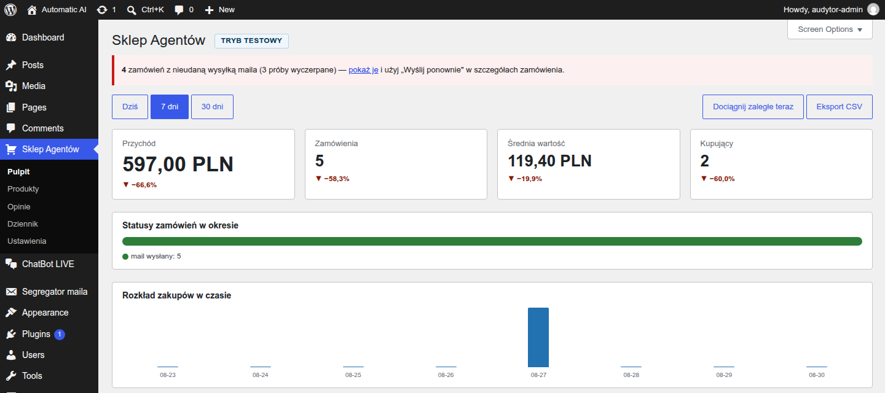
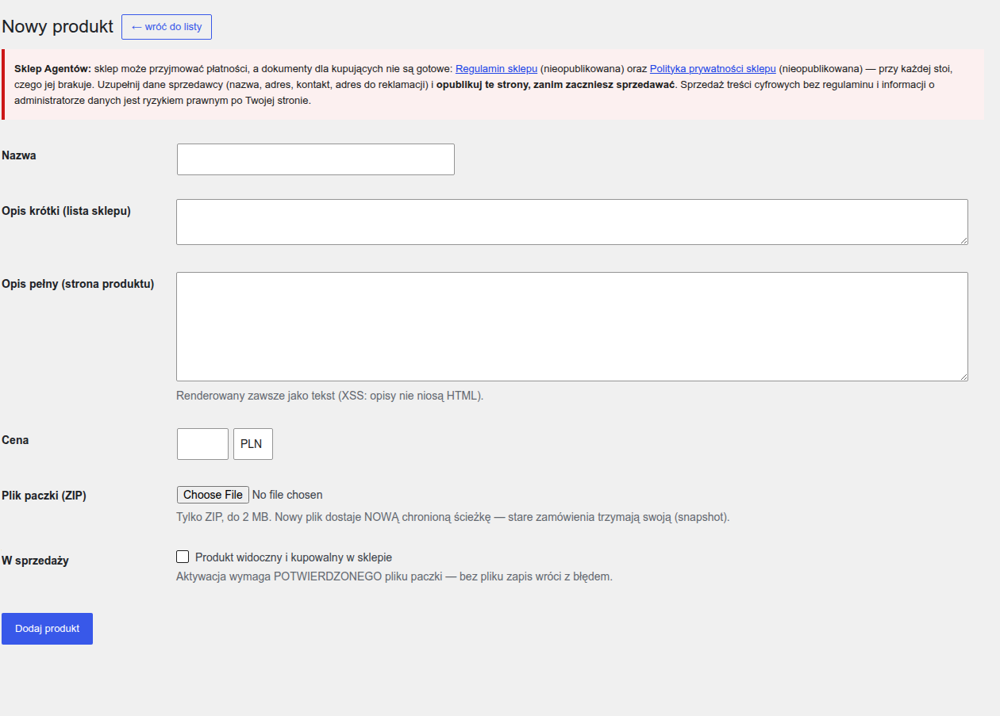
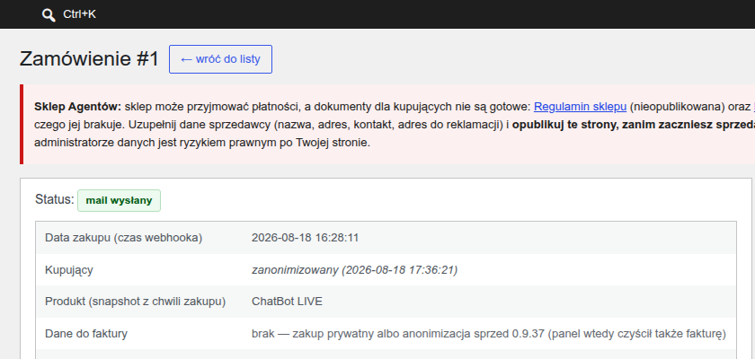
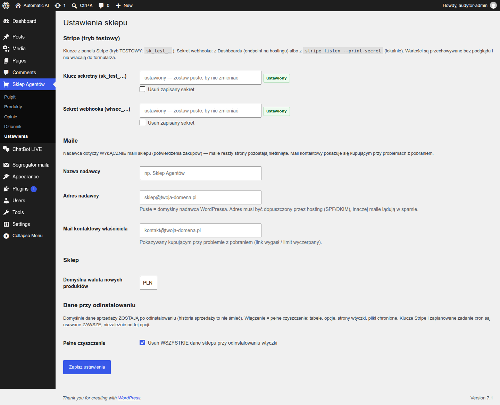

# Sklep Agentów — instrukcja właściciela

Ta instrukcja jest dla Ciebie — osoby, która prowadzi sklep z panelu WordPressa.
Instalację i konfigurację (odnośniki, klucze Stripe, webhook, pierwszy zakup testowy) opisuje
osobny plik `INSTRUKCJA-INSTALACJI.md`, dołączony do wydania obok paczek. Tutaj jest to, co robisz
**na co dzień**: produkty, zamówienia, maile do kupujących, opinie, dane osobowe, ustawienia.

Sklep sprzedaje pliki cyfrowe (paczki wtyczek) prosto z Twojej strony: kupujący płaci kartą
na stronie Stripe, dostaje mail z linkiem do pobrania, a Ty widzisz zamówienie w panelu.
Nie zakłada kont kupującym, nie ma abonamentu i nie wysyła danych nigdzie poza Stripe.

---

## 1. Panel — co gdzie jest

W kokpicie WordPressa, w menu po lewej, jest pozycja **Sklep Agentów** z pięcioma stronami:

| Strona | Do czego służy |
|---|---|
| **Pulpit** | wskaźniki sprzedaży, lista zamówień, eksport CSV, przycisk „Dociągnij zaległe teraz” |
| **Produkty** | dodawanie i edycja produktów, wgrywanie pliku ZIP, włączanie sprzedaży |
| **Opinie** | moderacja opinii kupujących — pojawiają się na stronie produktu dopiero po przyjęciu |
| **Dziennik** | logowania administratorów i zdarzenia sklepu |
| **Ustawienia** | klucze Stripe, nadawca maili, mail kontaktowy, dane sprzedawcy (stopka maila), waluta, dane przy odinstalowaniu |

Szczegóły pojedynczego zamówienia otwierasz z listy na Pulpicie przyciskiem **Szczegóły**.

Na górze Pulpitu bywa oznaczenie **TRYB TESTOWY**. Pojawia się wtedy i tylko wtedy, gdy klucz
sekretny Stripe w Ustawieniach zaczyna się od `sk_test_` (rozdział 8). Po wpisaniu klucza
produkcyjnego `sk_live_…` znika samo — razem z wszystkimi oznaczeniami widzianymi przez kupującego.

---

## 2. Produkty — jak dodać i wystawić na sprzedaż

**Sklep Agentów → Produkty → Dodaj produkt.**

1. **Nazwa** — pod tą nazwą produkt widnieje w sklepie, w mailu po zakupie i w zamówieniach.
   Z nazwy powstaje adres strony produktu: `/sklep/produkt/nazwa-produktu/`.
2. **Opis krótki** — jedno–dwa zdania na liście sklepu.
3. **Opis pełny** — treść strony produktu. Wpisujesz zwykły tekst; sklep nie przyjmuje
   znaczników HTML w opisach (to celowe zabezpieczenie).
4. **Cena i waluta** — cena w pełnych jednostkach (np. `149.00`). Waluta nowego produktu
   bierze się z Ustawień, tu możesz ją zmienić dla tego produktu.
5. **Plik paczki (ZIP)** — to, co kupujący pobiera. Wyłącznie ZIP, do 20 MB — ale nie więcej,
   niż pozwala Twój serwer: formularz pokazuje **mniejszy** z tych dwóch limitów (na zrzucie wyżej
   „do 2 MB”, bo tyle pozwalał serwer, na którym robiono zrzut).
   Sklep sprawdza plik po zapisie (obecność, rozmiar, suma kontrolna) i dopiero wtedy uznaje
   go za **potwierdzony**.
6. **W sprzedaży** — zaznacz „Produkt widoczny i kupowalny w sklepie”.
   ⛔ **Nie da się włączyć sprzedaży bez potwierdzonego pliku** — sklep nie sprzeda czegoś,
   czego nie ma czym wydać. Zapis wróci z komunikatem, dopóki nie wgrasz ZIP-a.

**Serwer nie przyjmuje pliku — jak podnieść limit**

Wgranie może odrzucić **PHP na Twoim serwerze**, zanim sklep w ogóle zobaczy plik. Rządzą tym
dwa ustawienia i oba muszą być większe od paczki, którą wgrywasz:

| Ustawienie | Co ogranicza | Typowa wartość u hostingów |
|---|---|---|
| `upload_max_filesize` | największy POJEDYNCZY wgrywany plik | 2 MB |
| `post_max_size` | całe wysłane zgłoszenie (plik **plus** pola formularza) | 8 MB |

Ustaw `post_max_size` **większe** niż `upload_max_filesize` (np. 32 MB i 25 MB) — inaczej plik
mieszczący się w pierwszym limicie odbije się od drugiego.

Sklep rozpoznaje **obie** sytuacje i mówi, która zaszła:

- plik przekracza `upload_max_filesize` → *„Wgranie pliku nie powiodło się (kod 1). Plik odrzucił
  serwer, zanim wtyczka go zobaczyła — obowiązuje limit 2 MB…"* — wpisana treść formularza
  **zostaje**, poprawiasz sam plik;
- całe zgłoszenie przekracza `post_max_size` → *„Serwer odrzucił CAŁE zgłoszenie…"* z podaniem
  obu limitów. Tu PHP wyrzuca formularz razem z plikiem, **zanim** WordPress wystartuje, więc
  wpisanej treści nie da się odtworzyć — to jedyny przypadek, w którym sklep jej nie uratuje.

Gdzie to zmienić — zależnie od hostingu, w kolejności od najczęstszego:

1. **panel hostingu** (cPanel/DirectAdmin: „Wybór wersji PHP" → „Options", albo zgłoszenie do
   pomocy technicznej) — jedyna droga na hostingu współdzielonym;
2. **`php.ini`** — `upload_max_filesize = 25M` i `post_max_size = 32M`;
3. **`.htaccess`** na Apache — `php_value upload_max_filesize 25M` i `php_value post_max_size 32M`
   (część hostingów tego zabrania i strona zwróci wtedy błąd 500 — wycofaj wpis).

Po zmianie odśwież formularz produktu: napis pod polem pliku (**„Tylko ZIP, do …"**) pokazuje
limit, który **naprawdę** obowiązuje — mniejszy z limitu serwera i limitu wtyczki (20 MB).
Jeśli nadal widnieje stara liczba, zmiana nie weszła w życie (najczęściej: nie przeładowano
PHP-FPM albo hosting ignoruje `.htaccess`).

**Co warto wiedzieć o edycji:**

- Każde zamówienie trzyma **kopię danych produktu z chwili zakupu** (nazwa, cena, plik).
  Późniejsza zmiana ceny czy nazwy nie zmienia historii sprzedaży, a nowy plik dostaną tylko
  **nowe** zakupy — stare zamówienia pobierają to, co kupiły.
- Nowy plik dostaje nową, chronioną ścieżkę na serwerze. Pliki produktów nigdy nie leżą pod
  publicznym adresem — wydaje je wyłącznie sklep, po sprawdzeniu linku z maila.
- Odznaczenie „W sprzedaży” chowa produkt ze sklepu, ale nie kasuje ani produktu, ani zamówień.

Lista sklepu (`/sklep/`) i strony produktów powstają same — nie musisz tworzyć ich w WordPressie.

---

## 3. Zamówienia — co widzisz i co możesz zrobić

**Sklep Agentów → Pulpit**, sekcja **Zamówienia**. Listę filtrujesz po statusie i datach,
szukasz po adresie e-mail, a **Eksport CSV** zapisuje dokładnie to, co masz w tej chwili
przefiltrowane.

**Statusy zamówienia:**

| Status | Co znaczy | Co robić |
|---|---|---|
| **oczekuje** | powiadomienie od Stripe przyjęte, zamówienie założone, ale sklep nie zdążył go domknąć (stan przejściowy na ułamek sekundy; płatność w toku — np. BLIK — NIE tworzy jeszcze zamówienia, zostawia tylko wpis `webhook_unpaid` w Dzienniku → Zdarzenia) | nic — odśwież; jeśli wisi dłużej niż kilka minut, to błąd zapisu w bazie: sprawdź oś czasu i napisz do wykonawcy („Dociągnij zaległe” tego statusu nie rusza) |
| **opłacone** | Stripe potwierdził płatność, mail jeszcze nie poszedł | nic — mail wychodzi za chwilę |
| **mail w toku** | sklep właśnie wysyła mail | poczekaj |
| **mail wysłany** | kupujący dostał link do pobrania | nic |
| **błąd maila** | ostatnia próba wysyłki nie powiodła się; sklep ponawia sam do trzech prób, potem zostaje ten status i pasek na Pulpicie | otwórz **Szczegóły → Wyślij ponownie**; jeśli błąd się powtarza — patrz rozdział 4 (SMTP) |
| **zwrócone** | Stripe zwrócił kupującemu **całą** kwotę | nic — sklep odnotował zwrot z powiadomienia Stripe i odjął go od statystyk. Zwrot **częściowy** nie zmienia statusu: kwota schodzi ze statystyk, a zwrot widać w osi czasu zamówienia |
| **obciążenie zwrotne** (spór) | kupujący zakwestionował płatność w banku (chargeback) — kwota zdjęta z Twojego konta do rozstrzygnięcia | odpowiadasz w panelu Stripe; spór wygrany albo wycofany → sklep wraca do poprzedniego statusu; spór przegrany → zamówienie zostaje jako obciążenie zwrotne |

Od 0.9.37 zwrot **całości** kwoty i **obciążenie zwrotne** (spór, w którym bank zdjął pieniądze z Twojego
konta; samo zapytanie z banku bez zdjęcia kwoty nie zmienia statusu) **odcinają** link do pobrania od razu: kupujący
zobaczy komunikat, że pieniądze wróciły (albo że płatność jest w sporze) i kontakt do Ciebie, a próba
zostanie zapisana w osi czasu zamówienia. Zwrot **częściowy** nie odcina dostępu (status się nie zmienia).
Spór wygrany albo wycofany przywraca poprzedni status — link znów działa do końca swojej ważności.

Pulpit pokazuje na górze czerwony pasek, gdy są zamówienia z nieudaną wysyłką — z linkiem
prosto do nich.

**Szczegóły zamówienia** (przycisk **Szczegóły** przy wierszu):

- data zakupu, kupujący, produkt (kopia z chwili zakupu), kwota, identyfikator sesji Stripe,
- **Pobrania** — ile razy z limitu 10 kupujący pobrał plik **z obecnego linku** i czy link jest jeszcze
  ważny; po każdej ponownej wysyłce (ręcznej albo automatycznej) licznik startuje od zera — historia
  wszystkich pobrań (z każdego linku) jest w osi czasu, przez 90 dni,
- **Zgoda na dostarczenie treści cyfrowej** — treść i czas zgody, którą kupujący zaznaczył
  przed zapłatą (ważne przy prawie do odstąpienia od umowy),
- **Treść wysłanego maila** — dokładnie to, co dostał kupujący, z przyciskiem **Wyślij ponownie**,
- **Dane osobowe (RODO)** — przycisk anonimizacji (rozdział 6),
- **Oś czasu** — każde zdarzenie tego zamówienia: płatność, wysyłki, pobrania, zwroty, kto co zrobił.
  Wpisy starsze niż **90 dni** usuwa zadanie WP-Cron sklepu co 10 minut — tylko gdy harmonogram WordPressa działa (tak jak cały Dziennik, rozdział 7) — jeśli potrzebujesz
  zapisu na dłużej (np. do sporu), zapisz go wcześniej; kwoty i statusy zamówień zostają na zawsze.

**„Dociągnij zaległe teraz”** (Pulpit, prawy górny róg). Zakup domyka się dwiema drogami:
Stripe wysyła powiadomienie (webhook) natychmiast, a niezależnie od tego sklep co 10 minut
sam dopytuje Stripe o opłacone sesje. Jeśli kupujący mówi „zapłaciłem, a nic nie przyszło”,
ten przycisk robi to dopytanie od ręki. Po kliknięciu Pulpit mówi, co zrobił: ile zakupów domknął,
ile sesji **pominął, bo są młodsze niż 2 minuty** (Stripe bywa jeszcze w trakcie — kliknij za chwilę
ponownie), ile jest otwartych i nieopłaconych (kupujący kliknął „Kup”, ale nie zapłacił — same wygasną).

⚠️ **„Co 10 minut” działa tylko wtedy, gdy WordPress potrafi uruchamiać swoje zadania w tle** (WP-Cron).
Na części hostingów i na stronach z małym ruchem to nie działa: Kokpit → Narzędzia → Kondycja witryny
pokazuje wtedy „Żądanie zwrotne (loopback) nie powiodło się” albo „zadania zaplanowane nie działają”.
Wtedy zakupy bez webhooka domyka **tylko** ten przycisk (i wejście na Pulpit, które też dopytuje raz na
10 minut) — albo poproś hosting o prawdziwy cron systemowy dla `wp-cron.php` (rozdział „Najczęstsze
problemy” w instrukcji instalacji).

---

## 4. Mail po zakupie i link do pobrania

Po opłaceniu kupujący dostaje **jeden** mail (sklep pilnuje, żeby nie wysłać dwóch), a w nim:

- link do pobrania — ważny **72 godziny**, do **10 pobrań**,
- potwierdzenie zgody na dostarczenie treści cyfrowej (dosłowna treść i data),
- krótką instrukcję instalacji wtyczki,
- informację o gwarancji, jeśli produkt ją ma,
- jednorazowy link do wystawienia opinii (ważny 30 dni),
- numer zamówienia (ten sam, który widzisz w panelu), datę i kwotę,
- stopkę z Twoimi danymi sprzedawcy z Ustawień (nazwa, adres, NIP, mail do reklamacji),
- **dane do faktury**, jeśli kupujący podał je przy zakupie (nazwa firmy, NIP, adres) — z informacją, że fakturę
  wystawia sprzedawca **poza sklepem** i prześle ją osobno, oraz gdzie kupujący ma się upomnieć, jeśli nie dotrze;
  gdy ich nie podał — zdanie „chcesz fakturę? odpisz w ciągu 3 miesięcy”.

**Faktura to Twoja robota, nie sklepu.** Sklep faktur nie wystawia — zbiera dane i pokazuje je w mailu
i w szczegółach zamówienia. Firmie fakturę musisz wystawić (ustawa o VAT: do 15. dnia następnego miesiąca),
osobie prywatnej — na jej żądanie zgłoszone w 3 miesiące. ⛔ Podanie NIP-u przez kupującego **nie odbiera mu
praw kupującego** (zgoda, gwarancja, reklamacje działają tak samo) — nie traktuj „jest NIP” jako „to firma,
bez zwrotów”: osoba prowadząca jednoosobową działalność, która kupuje poza swoją specjalnością, ma ochronę
konsumenta (art. 7aa ustawy o prawach konsumenta).

Mail jest w wersji graficznej — nazwa sklepu w nagłówku, okładka produktu, przycisk „Pobierz”,
kolory strony — a w tej samej wiadomości jedzie wersja tekstowa dla programów pocztowych bez
obrazków. Obrazek okładki ładuje się z Twojej strony, więc w skrzynce kupującego pokaże się
dopiero, gdy strona jest dostępna publicznie (na komputerze testowym zobaczysz zamiast niego
nazwę produktu). W panelu, w szczegółach zamówienia, podgląd pokazuje wersję tekstową.

**Wyślij ponownie** (w szczegółach zamówienia) wysyła mail ze **świeżym linkiem** — nowy termin
72 godzin i licznik pobrań od zera; poprzedni link przestaje działać. Gdyby wysyłka się nie udała,
sklep przywraca poprzedni link — ale tylko do następnej automatycznej próby (sklep ponawia sam po
ok. 2 minutach, do trzech razy): każda próba wydaje nowy link, a nieudana go nie cofa. Przy trwałej
awarii poczty poprzedni link więc przepada; gdy poczta znów działa, kliknij „Wyślij ponownie” —
kupujący dostanie świeży link z pełnym limitem.
Przycisk jest dostępny tylko dla zamówień w stanie „mail wysłany” albo „błąd maila”: dla zwróconych,
spornych i jeszcze niedomkniętych sklep odmawia. Uwaga na różnicę: przy zamówieniu **jeszcze
niedomkniętym** link, który kupujący już ma, działa do końca swojej ważności — ale przy **zwróconym
i spornym** nie działa, bo od 0.9.37 brama pobrań odmawia dla tych dwóch statusów.

Gdy link wygaśnie albo limit się wyczerpie, kupujący widzi na stronie pobierania Twój
**mail kontaktowy** z Ustawień — żeby napisał do Ciebie, a Ty użyjesz „Wyślij ponownie”.

⛔ **Wysyłką maili rządzi hosting, nie sklep.** Jeśli maile nie wychodzą (status „błąd maila”
albo mail ląduje w spamie), skonfiguruj wysyłkę przez SMTP dowolną wtyczką SMTP i ustaw
w Ustawieniach nadawcę z adresem w Twojej domenie.

---

## 5. Opinie kupujących

**Sklep Agentów → Opinie.** Trzy zakładki: **Oczekujące**, **Przyjęte**, **Odrzucone**.

Opinię może wystawić wyłącznie kupujący — z jednorazowego linku w mailu po zakupie, jedna
opinia na zamówienie, w ciągu 30 dni. Nie ma ocen od anonimowych gości ani zbiorczej średniej.

Nowa opinia trafia do **Oczekujących** i **nie jest widoczna** na stronie produktu, dopóki nie
klikniesz **Przyjmij**. **Odrzuć** chowa ją; możesz ją później przyjąć z zakładki Odrzucone. Wyjątek: opinia kupującego,
którego dane zanonimizowałeś (rozdział 6), ląduje w Odrzuconych z etykietą **[ ZANONIMIZOWANA — RODO ]**
i nie da się jej już przyjąć ani odrzucić — sklep odmawia na stałe. Strona Opinii pokazuje też, ile maili z linkiem do opinii wysłano bez odpowiedzi.

---

## 6. Dane osobowe (RODO)

Co sklep przechowuje o kupującym: adres e-mail z płatności Stripe, kwotę, czas i treść zgody,
historię pobrań (każde pobranie z adresem internetowym, z którego przyszło — w osi czasu zamówienia);
jeśli kupujący wystawił opinię — jego **imię, tytuł i treść opinii** (imię, tytuł i treść są publikowane
na stronie produktu, za zgodą z formularza). Dane karty obsługuje wyłącznie Stripe — na Twoim serwerze ich nie ma.

**Anonimizacja na żądanie kupującego:** Szczegóły zamówienia → **Dane osobowe (RODO)** →
przycisk anonimizacji. Sklep usuwa adres e-mail z zamówienia i z dziennika zdarzeń (**dane do faktury zostają** — nazwa, NIP i adres nabywcy podlegają obowiązkowi podatkowemu i tak samo traktuje je kasownik RODO WordPressa; od 0.9.37, wcześniej panel je kasował) — razem z zapisaną treścią maila, która niosła kopię tych danych; przy opinii
tego zamówienia kasuje **imię** i zdejmuje opinię ze strony produktu (trafia do Odrzuconych, bez
możliwości przywrócenia — treść i ocena zostają w bazie, już bez autora); unieważnia link do pobrania (zanonimizowany kupujący nie ma już dokąd dostać
świeżego linku) i zapisuje datę anonimizacji. **Kwoty i czasy zostają** — statystyki sprzedaży
nie tracą historii. Operacja jest nieodwracalna. Adresów internetowych przy pobraniach anonimizacja
**nie** usuwa — znikają razem z całą osią czasu po 90 dniach (rozdział 7); odpowiadając kupującemu
na pytanie, co sklep o nim ma, wymień też je.

**Wniosek przez narzędzia WordPressa (Narzędzia → Eksportuj / Usuń dane osobowe):** to ta sama
droga, którą obsługujesz wnioski wobec całej strony, i sklep jest w nią wpięty. Wpisujesz adres
e-mail, WordPress wysyła prośbę o potwierdzenie i po potwierdzeniu składa raport.
- **Eksport** oddaje zamówienia kupującego (numer, data, produkt, kwota, status, dane do faktury),
  jego opinie i sesje płatności. Duża historia zakupów schodzi partiami — WordPress woła sklep
  tyle razy, ile trzeba, i składa jedną paczkę ZIP.
- **Usunięcie** anonimizuje wszystkie zamówienia tego adresu — dokładnie tak, jak przycisk
  z panelu: **dane do faktury zostają** w obu drogach (od 0.9.37; do 0.9.36 przycisk z panelu
  czyścił je). Wymaga tego prawo podatkowe (ustawa o VAT każe trzymać adres nabywcy z faktury),
  więc raport WordPressa mówi wprost, że część danych zachowano i dlaczego. Przeczytaj ten raport, zanim odpiszesz kupującemu — jest w nim
  także ostrzeżenie, gdyby któregoś zamówienia nie udało się zanonimizować.
- Przycisk z panelu robi **to samo** co wniosek, tylko dla jednego zamówienia i bez raportu:
  usuwa adres i treść maila, **dane do faktury zostawia**. Różnica jest w drodze, nie w skutku:
  przycisk to Twoja decyzja przy jednym zamówieniu, wniosek obejmuje wszystkie zamówienia adresu.

Jeśli usunięcie nie uda się w całości (np. błąd zapisu), sklep **nie udaje**, że się udało:
pokazuje błąd, nie potwierdza usunięcia (dane mogą nadal być w bazie — nie potwierdzaj ich
usunięcia osobie, która o to prosiła), w osi czasu pojawia się zdarzenie błędu, a Ty powtarzasz
operację, aż przejdzie.

Przy instalacji powstają dwa szkice stron: **Regulamin sklepu (SZABLON)** i **Polityka
prywatności sklepu (SZABLON)**. Uzupełnij je swoimi danymi sprzedawcy i opublikuj, zanim
zaczniesz sprzedawać naprawdę — dopóki tego nie zrobisz, w panelu wisi czerwone ostrzeżenie,
a linki „regulamin sklepu” i „polityka prywatności” przy przycisku zakupu prowadzą kupującego
na stronę „w przygotowaniu” (nigdy na szkic z zaślepką i nigdy na błąd 404).

**Co robi sama wtyczka po aktualizacji** (od 0.9.42; wcześniej strony powstawały wyłącznie przy
pierwszej instalacji, więc sklep zaktualizowany „w miejscu” nie dostawał ich nigdy): przy
pierwszym otwarciu **panelu** (Kokpitu) po aktualizacji — albo przy najbliższym biegu zadania cyklicznego —
wtyczka ogląda obie strony i zależnie od ich stanu (na stronie sklepu nic nie robi, żeby kupujący nie czekał):

- **strony nie ma** (skasowałeś ją albo instalacja jest starsza niż wersja, w której szkice
  powstały) — zakłada ją od nowa, jako **wersję roboczą** z zaślepką SZABLON. Nie publikuje
  jej za Ciebie: treści prawnej nikt nie napisze za sprzedawcę;
- **strona nadal jest szablonem** (słowo SZABLON zostało w tytule albo w treści) — dopisuje na
  jej końcu **tylko te sekcje wzoru, których w niej nie ma**. Tego, co już wpisałeś, nie rusza
  i niczego nie dubluje;
- **strona jest już Twoim dokumentem** (zaślepki SZABLON w niej nie ma) — **wtyczka nie zmienia
  w niej ani znaku**. Zamiast tego pokazuje w panelu żółty komunikat z **nazwami sekcji**,
  których u Ciebie nie widzi (np. „Cena”, „Procedura reklamacyjna”).

**Co robisz sam.** Wypełnij miejsca w nawiasach kwadratowych, usuń słowo SZABLON z tytułu
i treści, opublikuj. Gdy zobaczysz żółty komunikat o nowych sekcjach: sprawdź, czy masz te
sprawy opisane u siebie pod inną nazwą — jeśli tak, zignoruj; jeśli nie, dopisz je ręcznie
(wymaga ich art. 12 ust. 1 ustawy o prawach konsumenta). Wtyczka porównuje po nazwach sekcji
i nie potrafi rozpoznać Twojego własnego nazewnictwa — dlatego pyta zamiast poprawiać.

Rzeczy **wewnątrz** sekcji (nie osobna sekcja) — tu samoobsługa działa tylko częściowo:

- **Polityka prywatności — zdanie o sprzątaniu dziennika.** Jeśli w Twojej polityce stoi jeszcze brzmienie
  z wersji 0.9.23–0.9.40 („dziennik zdarzeń (90 dni, w tym adres IP przy każdym pobraniu pliku)”), wtyczka
  **sama** podmienia je na prawdziwe: sprzątanie jest warunkowe (zadanie WP-Cron co 10 minut, tylko gdy harmonogram
  WordPressa działa), obejmuje dziennik zdarzeń i historię logowań, a dane zamówień nie są usuwane po czasie.
  Jeśli to zdanie przepisałeś po swojemu, wtyczka go nie tknie — zobaczysz żółty komunikat „Zakres (zdanie
  o sprzątaniu: warunkowe, WP-Cron)” i dopisujesz tę prawdę sam, własnymi słowami. ⛔ Nie wpisuj już starego
  brzmienia „90 dni” bez warunku — było nieprawdziwe (gdy WP-Cron stoi, nic nie znika);
- **Polityka prywatności** z wersji wcześniejszej niż 0.9.23: dane do faktury (nazwa, NIP, adres — cel: faktura,
  podstawa: obowiązek prawny z ustawy o VAT) w opisie zakresu danych — tego wtyczka nie podmienia, dopisz sam;
- **Regulamin** z wersji wcześniejszej niż 0.9.40: punkt o gwarancji satysfakcji — że jest to
  **dobrowolne zobowiązanie sprzedawcy PONAD ustawę**, niezależne od utraty prawa odstąpienia
  z art. 38 — bo strona produktu tę gwarancję obiecuje, więc regulamin musi ją potwierdzać.

---

## 7. Dziennik

**Sklep Agentów → Dziennik**, dwie zakładki:

- **Logowania** — udane i nieudane logowania do kokpitu, z adresem, z którego przyszły.
  Po nieudanych próbach sklep wydłuża czas odpowiedzi (do minuty), a od siódmej próby w ciągu
  minuty z tego samego adresu odmawia na minutę — spowalnia zgadywanie hasła, nie blokuje konta
  na stałe.
- **Zdarzenia** — to samo, co osie czasu wszystkich zamówień, w jednym miejscu: płatności,
  wysyłki, pobrania, zwroty, spory, anonimizacje, eksporty CSV.

W **obu** zakładkach — a więc także w osiach czasu zamówień — wpisy starsze niż **90 dni** usuwa
zadanie WP-Cron sklepu (sprzątanie co 10 minut) — tylko gdy harmonogram WordPressa działa; gdy stoi, wpisy zostają. Zamówienia, kwoty i statusy zostają.

---

## 8. Ustawienia

**Sklep Agentów → Ustawienia.**

- **Klucz sekretny Stripe** i **Sekret webhooka** — wklejasz raz; sklep przechowuje je bez
  podglądu i nie wraca ich do formularza (widzisz tylko „ustawiony”). Puste pole przy zapisie
  = bez zmian; kasujesz przez „Usuń zapisany sekret”.
- **Nazwa i adres nadawcy** — tylko dla maili sklepu; reszta poczty WordPressa zostaje bez zmian.
  Adres musi być dopuszczony przez Twój hosting (SPF/DKIM), inaczej maile lądują w spamie.
- **Mail kontaktowy właściciela** — pokazywany kupującemu przy **każdym** problemie z pobraniem:
  zły link, link wygasł, zwrot lub spór, plik chwilowo niedostępny, wyczerpany limit (pięć miejsc);
  w mailu po zakupie stoi jako adres do reklamacji i faktur.
- **Klucz publikowalny (pk_test_…)** — z tego samego miejsca w Stripe co klucz sekretny. **Z kluczem** formularz
  karty pokazuje się na stronie produktu, w kolorach strony (kupujący nie opuszcza Twojej strony; dane karty
  i tak idą prosto do Stripe, w ramce Stripe). **Bez klucza** kupujący przechodzi na stronę płatności Stripe —
  wszystko działa, tylko wygląda jak Stripe, nie jak Twoja strona. Klucz jest jawny (trafia do przeglądarki).
- **Dane sprzedawcy** — nazwa firmy, adres, NIP: trafiają do stopki każdego maila po zakupie.
  Potwierdzenie zakupu na trwałym nośniku ma zawierać dane przedsiębiorcy (ustawa o prawach
  konsumenta, art. 21), więc dopóki są puste, Pulpit pokazuje ostrzeżenie. NIP sklep sprawdza
  przy zapisie (10 cyfr z sumą kontrolną).
- **Domyślna waluta nowych produktów.**
- **Dane przy odinstalowaniu** — domyślnie po usunięciu wtyczki dane sprzedaży **zostają**
  w bazie (historia zamówień to nie śmieć). Zaznaczone „Pełne czyszczenie” usuwa przy
  odinstalowaniu tabele, ustawienia, strony sklepu i pliki chronione. Klucze Stripe
  i zaplanowane zadanie sklep usuwa zawsze.

**Tryb testowy a sprzedaż naprawdę.** Dopóki w Ustawieniach jest klucz sekretny testowy
(`sk_test_…`), płatności nie są pobierane. **Tryb bierze się z prefiksu tego klucza — nie ma
osobnego przełącznika do zapomnienia.** Oznaczenia trybu testowego (na Pulpicie, na liście sklepu,
na stronie produktu, na stronie po zapłacie, w panelu zamówienia i w obu wersjach maila) pojawiają
się i znikają razem z nim: po wpisaniu klucza `sk_live_…` sklep przestaje pisać, że nie pobiera
pieniędzy. ⛔ Klucz sekretny to jednak nie wszystko, co trzeba zmienić przed prawdziwą sprzedażą —
webhook produkcyjny, wysyłka maili i dokumenty sprzedawcy to osobne kroki. Pełną listę znajdziesz
w `INSTRUKCJA-INSTALACJI.md`, rozdział „Test a produkcja”.

---

## 9. Najczęstsze pytania

**Gdzie kupujący wpisuje kartę?** Gdy w Ustawieniach jest klucz publikowalny — na stronie produktu, w panelu
płatności pod przyciskiem „Kup teraz” (pola karty to ramka Stripe: numer karty nigdy nie trafia na Twój serwer).
Gdy klucza nie ma albo kupujący ma wyłączone skrypty — na stronie płatności Stripe, jak dawniej. Obie drogi
kończą się tą samą stroną „Dziękujemy” i tym samym mailem.

**Kupujący podał NIP — co robię?** Dane są w mailu i w szczegółach zamówienia (wiersz „Dane do faktury”).
Wystawiasz fakturę w swoim programie księgowym i wysyłasz na jego e-mail; sklep nic tu nie automatyzuje.
Anonimizacja (rozdział 6) usuwa e-mail i treść maila, ale **dane do faktury zostawia** (od 0.9.37; ustawa
o VAT każe je trzymać) — wiersz „Dane do faktury” w szczegółach zamówienia dalej je pokazuje.

**Zakup „wisi” na stronie Dziękujemy.** Powiadomienie od Stripe nie dociera — najczęściej
przez zły sekret webhooka (sekret z panelu Stripe i z narzędzia Stripe CLI to dwa różne
sekrety). Sklep i tak domknie zakup w ciągu ok. 10 minut (jeśli WP-Cron działa — rozdział 3), a od ręki
zrobi to „Dociągnij zaległe teraz” na Pulpicie — **odczekaj 2 minuty od zapłaty**, bo młodsze sesje
przycisk pomija (i mówi, ile pominął).

**Mail z linkiem nie przyszedł.** Treść maila jest w szczegółach zamówienia razem
z „Wyślij ponownie”. Jeśli wysyłki padają regularnie — SMTP (rozdział 4).

**Nie mogę włączyć sprzedaży produktu.** Brak potwierdzonego pliku ZIP (rozdział 2).

**Wgrywam ZIP i dostaję „Serwer odrzucił CAŁE zgłoszenie" albo pustą stronę.** Paczka przekracza
`post_max_size` Twojego serwera — limit sklepu (20 MB) nie ma z tym nic wspólnego, bo walidacja
sklepu w ogóle się nie uruchamia. Jak podnieść oba limity PHP: rozdział „Produkty", akapit
„Serwer nie przyjmuje pliku — jak podnieść limit". (Pustą stronę pokazywały wydania do 0.9.35;
od 0.9.36 sklep mówi, ile serwer przyjmuje i które ustawienie o tym decyduje.)

**Strona produktu pokazuje 404.** Ustawienia → Bezpośrednie odnośniki → Zapisz zmiany
(odświeżenie reguł adresów). Struktura odnośników musi być inna niż „Zwykłe”.

**Kupujący chce zwrotu.** Zwrot robisz w panelu Stripe; sklep sam odnotuje go w zamówieniu
(status „zwrócone”, kwota w osi czasu) i odejmie od statystyk sprzedaży. Jeśli kupujący ma
jeszcze otwartą stronę „Dziękujemy” (albo wróci na nią ze starego odnośnika), przeczyta tam
**„Płatność za to zamówienie została zwrócona — nie jest już opłacone, a link do pobrania z maila
przestał działać”**, a przy sporze — **„Ta płatność jest w sporze (reklamacja w banku) — link do
pobrania nie działa. Dostęp wróci tylko wtedy, gdy spór rozstrzygnie się na korzyść sklepu”**.
Strona przestaje wtedy odświeżać status. Oba zdania mówią o linku wprost, bo brama pobrań
faktycznie odmawia dla statusów „zwrócone” i „sporne” (patrz ostrzeżenie w rozdziale 3).

**Czy pliki są bezpieczne na serwerze nginx?** Katalog plików chroni `.htaccess`, który
działa na Apache, a na nginx jest ignorowany. Prawdziwą ochroną jest brama w sklepie (token,
termin, limit) i losowa nazwa katalogu — na nginx dołóż regułę blokującą ten katalog po stronie
serwera (opis w `DOKUMENTACJA-TECHNICZNA.md`).

**Czy kupujący zakłada konto?** Nie. Zakup bez konta: e-mail podany na stronie płatności
Stripe, link w mailu, jednorazowy link do opinii.

---

## 10. Odinstalowanie

Wtyczki → Sklep Agentów → Wyłącz → Usuń. Co zostaje, decyduje ustawienie „Dane przy
odinstalowaniu” (rozdział 8). Strony sklepu, produkty i zamówienia zostają, dopóki nie włączysz
pełnego czyszczenia; klucze Stripe i zadanie cykliczne znikają zawsze.

---

Masz pytanie, którego tu nie ma? Napisz do nas — instrukcja rośnie o to, o co pytają właściciele.
